# StarPaper

让论文像星星一样闪耀，充满希望


<details><summary>更新记录</summary>


**2026-10-14 15:53 · 绘图与模板归入对应章节 · skill 更新**

- 取消独立绘图章：Mainfig 放引言，Framework 放方法，实验图与表格放实验。
- 第一章缩短；贡献总结合并到引言模板，通用绘图规范集中放全文规范。
- 目录改为初稿、精修、工具三章，保留旧链接；公开写作包同步贡献与表格模板。绘图包同步导航说明。

**2026-10-14 15:01 · 新增目录、铁律漫画与引用模板 · skill 更新**

- 开头按章节列用途，初稿说明改为使用 Codex skill 后逐节精修。
- 两幅简图说明前后对应与实验归因，合并重复文字。
- 补齐会议、期刊与 arXiv 的 BibTeX 模板，更新公开写作 skill。

**2026-10-14 13:29 · 全文语言精简 · skill 更新**

- 删重复，拆长句，压缩旁批。
- 提示词与公开 skill 同步精简，章节划分不变。

**2026-10-14 13:02 · 正文结构：实验与篇幅提醒**

- 补充实验充分性、正文篇幅与投稿前自查的作者经验。

**2026-10-14 12:59 · 标题示范以真实论文为准 · skill 更新**

- 加入 Careful Queries, Credible Results，拆解记忆点、研究目标与实现手段。
- 删除缺少真实论文示范的设计型、问句型和发现型模板；保留模板仅供参考，同步公开写作 skill。

**2026-10-14 12:48 · 标题模板与简称命名 · skill 更新**

- 标题补充设计型、问句型、发现型、目标型与简称型，注明模板仅供参考。
- 用 Unlocking Proactivity、SEAD 和 SAGE 说明标题结构、简称来源与正文加粗方式；同步公开写作 skill。

**2026-10-13 21:46 · 正文精修全文检查 · skill 更新**

- 按论文类型区分引言贡献，修正占位句法与全文对应图。
- 补全方法输入输出交接，统一消融设置、统计说明与 LaTeX 引用。
- 参考文献分为正文引文与 BibTeX 两块；合并重复规则，区分铁律与排版建议。
- 公开写作 skill 同步正文模板和各类引言模板。

**2026-10-13 21:17 · 正文精修改为顺序填空模板 · skill 更新**

- 按论文顺序集中展示各节职责、逻辑要求与填空模板；旁批解释句子位置，不再讲某篇论文的改词记录。
- 摘要支持多个局限并用粗斜体强调关键词，结尾放关键实验数字和结论。
- 方法、指标、消融、案例分析及文末章节统一为通用模板；网页与按章节拆分的写作 skill 同步。

**2026-10-13 16:01 · 绘图流程与实验写作模板**

- Mainfig、Framework 与实验图按内容、排版、编码三个阶段展开，加入连续示意与元素语义说明。
- Metrics 改为编号的紧凑自然段；消融按模块配对 Setting 与 Results，补充结果表模板。
- 新增 Case Study 模板与选例、图中注解要求；增加悬浮回到顶部按钮。
- 公开写作下载包同步新增实验模板，latest 标注本次时间；本地私有 skill 未改动。

**2026-10-13 14:12 · 批注与原文对齐**

- 批注卡片跟随对应正文滚动，上、下方显示其余批注数量，点击可跳转。
- 相邻批注错开，点选原文后优先对齐；回复框随卡片显示并保留输入。
- 手机使用底部批注面板，保留正文可见区域。

**2026-10-13 12:25 · 新增评论与批注点赞**

- 评论、回复与批注支持点赞；同一浏览器对每条留言只计一次。
- 去掉私密评论选项，新评论与批注统一公开；历史私密留言不公开。
- 副标题更新为“让论文像星星一样闪耀，充满希望”。
- 打卡旁增加 GitHub Star 入口，由读者在仓库主动点击。

**2026-10-13 12:00 · 补充统计图读法与写作模板**

- 补充小样本、散点遮挡、连续色标、气泡面积与误差线的五组教学图。
- Method Overview 模板前置显示，Intro 方法介绍段增加固定开头句。
- 来源集中到文末“相关参考和推荐阅读”，同步写作与绘图下载包。

**2026-10-13 11:13 · 新增开头点赞打卡**

- 页面开头显示累计打卡人数；同一浏览器只计一次，重复点击播放 ACCEPT 与星星动画。
- 保留已有点赞累计与浏览统计，适配手机、深色模式及减少动画设置。

**2026-10-13 00:38 · 更名 StarPaper，更新写作 skill · skill 更新**

- 统一教程、博客、仓库与网址名称；新增流星标题图与夜空 ACCEPT 主图。
- 写作包新增独立 cs-limitations，按九个章节模块加载；补齐单段两点模板与 Metrics 格式。
- 区分讨论与局限性，核对贡献格式、篇幅要求和全文范围的一致性。

**2026-10-12 16:31 · 补全历史更新记录**

- 补回首次发布以来的主要更新，按时间倒序显示；无序号，下拉栏可滚动查看。

**2026-10-12 16:08 · 精简论文绘图章节**

- 正文改为 Mainfig、Framework 与实验绘图三节，每节两个模板例子。
- 融入绘图笔记、标出铁律，增加同一内容或数据的优化前后教学对照。
- 其余 18 张图移至文末“收集的参考绘图”，保留出处、许可与点评。

**2026-10-12 15:50 · 更新评论与批注入口**

- 评论、批注和页脚统计使用同一可用服务入口，保留已有评论与公开／私密设置。

**2026-10-12 15:36 · 新增点赞与浏览统计**

- 页脚显示共享点赞数与浏览次数，点赞可取消；重复请求去重，统计从启用后累计。

**2026-10-12 14:58 · 补全写作与绘图 skill 介绍**

- 网页和 README 写明技能名称、用途、源码与下载入口；补充中英文搜索摘要和仓库主题标签。

**2026-10-12 14:44 · 同步写作与绘图 skill · skill 更新**

- 补齐数字与文献版本口径、Related Work 的应用字段。
- 更新实验章首模板、有效评估范围、判分可靠性与章节承接。
- 补齐图注、脚注和移图规范；下载链接标出 latest，新增折叠更新记录。

**2026-10-12 12:54 · 更名 BeautyPaper**

- 更新西施犬展示论文、三位评委举起 ACCEPT 的主图，并同步博客封面。

**2026-10-12 12:23 · 写作 skill 按章节拆分 · skill 更新**

- 拆为入口、共享规则和六个章节；同步钩子、引言结构、贡献格式与 Related Work 收尾。

**2026-10-11 19:16 · 区分铁律与建议 · skill 更新**

- 只给必须遵守的要求标注铁律，调整正文与 skill 的规则措辞。

**2026-10-11 17:27 · 补齐精修要求 · skill 更新**

- 完善篇幅分配、各章节规范与提交前检查，同步写作 skill。

**2026-10-11 15:48 · 增加全文组织模板**

- 提供方法论文、基准与数据集论文、诊断驱动研究的章节结构与衔接方式。

**2026-10-11 14:14 · 补全章节对应关系**

- 用图展示引言如何连接方法、实验、结论和局限，补充论文大纲。

**2026-10-11 13:52 · 集中段落批注示范**

- 精修部分改为章节原则与完整段落批注，收拢零散中英例子。

**2026-10-11 01:40 · 分开写作与绘图技能 · skill 更新**

- 提供独立下载入口，更新主页主图，增加单栏 Mainfig 参考。

**2026-10-10 17:53 · 精简教程语言 · skill 更新**

- 删去重复解释和口号，统一为简洁、直接的表达，同步下载 skill。

**2026-10-10 16:40 · 补入章节目的与写作笔记**

- 说明各章如何支撑贡献，完善正文与绘图的对应指导。

**2026-10-10 16:09 · 发布独立绘图 skill**

- 增加下载与使用入口，整理绘图规范、常见错误及对应图例。

**2026-10-10 15:45 · 说明 Overleaf 同步条件**

- 补充项目 owner 的会员要求，以及本地编译和跳过同步的替代方式。

**2026-10-10 15:06 · 完善草稿流程**

- 补充材料填写、图表准备、章节组织和正文审核，并提供图表模板。

**2026-10-10 11:03 · 支持正文批注**

- 增加选文批注、公开回复侧栏与评论入口。

**2026-10-08 18:51 · 补齐章节规范与图例 · skill 更新**

- 整理全文要求、各章模板与逐图点评，并同步写作 skill。

**2026-10-08 16:52 · 按写作流程重组教程**

- 分为草稿、绘图、精修和辅助工具四部分。

**2026-10-08 12:40 · 增加快速起草入口**

- 提供可填写的 Codex 提示词，按论文顺序整理正文指导。

**2026-10-07 16:09 · 扩充论文示例来源**

- 加入多个研究方向的论文例子，完善来源说明。

**2026-10-07 15:30 · 发布写作 skill 与铁律**

- 增加 skill 下载、安装说明及写作规则。

**2026-10-07 15:01 · 整理研究工具**

- 按用途收录文献、绘图、翻译与代码阅读工具，附使用说明。

**2026-10-07 14:41 · 补全论文示例与来源标注**

- 为写作条目补充中英示例，标明出处与许可。

**2026-10-07 13:32 · 首次公开 PaperBank**

- 发布写作教程、示例、参考来源与转载使用条款。

</details>


写作与绘图 skill，可直接下载使用。
[cs-paper-writing](../assets/cs-paper-writing-skill.zip) latest:【2026-10-14 15:53】 · [绘图](../assets/starpaper-figures-skill.zip) latest:【2026-10-14 15:53】 · [用法](#writing-skill)


## 写在前头

cs-paper-writing 按章节加载写作规则。starpaper-figures 支持方法图、案例图和实验图。

这里整理我的论文写作与修改经验，供学术讨论。本人并非领域权威，内容可能有误。

网页开源，支持批注。欢迎纠错、讨论写法，我会据此修订。

*多数例子来自本人、本人参与或熟人的论文。其余选自公开论文，均附出处。用于研究时，请引用对应原论文。*


## 目录与用途

- [1. 初稿准备](#quick-start)：整理材料，用 Codex 生成初稿
- [2. 正文精修](#refine)：按论文顺序，逐节修改正文与图表
- [3. 辅助工具](#tools)：查文献、做图表、核对引用

先用 Codex 起草正文与关键图，再由作者审核逻辑、逐章精修。第三章为辅助工具。

主要面向方法与实证研究；按学科、研究类型和投稿要求调整。模拟段落明确标注，真实论文摘录另给出处与版本。

欢迎使用、改写、转载，也欢迎给 Codex 用作 skill。原创内容采用 CC BY 4.0，论文摘录与图片保留各自许可。转载原创内容请保留作者 Da1yuqin、[原文链接](https://da1yuqin.github.io/StarPaper/)和 [CC BY 4.0](https://creativecommons.org/licenses/by/4.0/) 许可，修改版本注明改动。如有帮助，欢迎 Star。

<a id="quick-start"></a>
## 1. 初稿准备

准备材料与模板，用 Codex skill 起草，再按[正文精修](#refine)逐节修改。

<a id="draft-step-1"></a>
### 1.1 研究材料与模板

整理研究问题、已有局限、对应设计与真实结果。附可核对的文献、图与数据。下载会议当年的官方模板，核对页数并编译。使用 Overleaf 时，先同步最新源文件。Git 同步需要项目 owner 有会员或相应权限。没有则下载源文件 ZIP，本地编译；也可跳过同步。写明允许修改的文件。把材料填入提示词，让 Codex 生成提纲和初稿。

**填写研究材料，生成初稿**

```text
读取 cs-paper-writing/SKILL.md。
先读共享规则，再加载当前章节。
核对会议及 track 的 AI 规定与材料权限。
遵守当前授权范围，按要求披露 AI 使用。
未经许可，不外传未公开稿件、review、个人数据或密钥。
会议、官方模板、正文页数与附录规定：【】
研究问题与已有不足：【】；真实设计与依据：【】
实验材料、指标、对照与实测结果：【】
参考论文及借鉴部分：【】；允许修改：【】

1. 核对模板并编译。
   保留最新源、原始结果与合作者修改。
2. 梳理参考论文的章节职责、顺序和输入输出。
   据此拟定大纲，只借鉴组织，不复制措辞或主张。
3. 先完成关键图，对应问题、设计与证据。
   读取 cs-visuals，精修图形时另读绘图 skill。
4. 列出各节标题、任务、证据和篇幅。
   Method Overview 承接困难，串起输入输出。
   各模块先讲动机，再讲设计。
5. 按主张组织实验，给出对应证据。
   整体结果、局部差异、条件分析分别交代范围与分母。
   不补造分析、标题或结果。
6. 引言依次说明已有能力、不足、解法和发现。
   写明机制与用途，段首承接具体对象。
7. 贡献用原生 itemize，固定三项。
   第一项写整体工作，第三项写实验发现。
   第二项按论文类型写关键设计或证据贡献。
   可写机制、构建、评价、比较或测量，不虚构工作。
8. 先交中文提纲和证据，再按授权写英文。
   核对数值、引用、图表、分页与最终 PDF。
   远端源与服务端 PDF 分开核验。
9. 局限性读取 cs-limitations。
   用单段 First / Second 写两点。
   每点先肯定有据工作，再说明具体边界。
```

[规则依据与完整提示词](https://github.com/Da1yuqin/StarPaper/blob/main/skills/cs-paper-writing/references/prompts.md#draft)

<a id="draft-step-3"></a>
### 1.2 正文结构

提醒小伙伴：实验要充足，正文篇幅要用足！我的排版目标是：***最后几页每页至少一项实验及其分析。正文一定要写满投稿限制的最大内容。例如 limit 8 页，一定要写满 8 页***。补充必要的对照、消融与边界分析。这是个人经验，须按研究内容与会议要求调整。

师兄说：“把审稿人当作魔鬼。”先问自己：实验够吗？比较公平吗？结论有证据吗？其他章节同样检查，别留解释缺口。关键实验缺失、论证不足，都可能导致拒稿。

先用 [Codex 写作 skill](#writing-skill) 生成初稿。生成后，按[正文精修](#refine)逐节修改。

<details><summary>参考大纲：按论文类型选结构</summary>

#### 论文大纲与章节衔接

先按核心贡献选论证主线，再排全文章节。诊断驱动论文须先用证据确立发现。不能只换引言标题。下列三套仅供参考，段落、模块与节号按需调整。

| 论文类型 | 引言的论证顺序 | 正文的展开顺序 |
| --- | --- | --- |
| 方法论文 | 背景与回顾 → 局限 → 设计 → 发现 → 贡献总结 | Related Work → Method → Experiments → Conclusion |
| 基准与数据集论文 | 能力与评价 → 缺口及建设障碍 → 产物与设计 → 发现 → 贡献总结 | Related Work → Construction → Evaluation → Conclusion |
| 诊断驱动的改进研究 | 能力判断 → 质疑与发现 → 瓶颈 → 设计 → 验证 → 贡献总结 | Diagnostic Analysis → Method → Experiments → Related Work → Conclusion |

<a id="structure-method"></a>
<details><summary>方法论文：大纲与章节衔接</summary>

核心贡献是新方法或系统设计。先说已有局限，再说对应设计。最后检验整体效果与设计作用。

<a id="draft-paper-outline"></a>
#### 方法论文：局限 → 设计 → 验证

方括号填对象、动作与证据。节名和编号仅作示意。图示串行方法；并行或反馈须画出实际关系。

Abstract：概括问题、贡献与关键发现。主张、术语和范围与正文一致。通常待主要结果确定后定稿。

**1 Introduction**

为什么要研究[问题]？已有路线哪里不足？本文怎样处理？实验发现什么？

- **背景与比较**：交代领域目标、已有进展与比较依据。前两段可穿插或合并。

- **具体局限**：However, [limitation] ... 说明限制条件。解释现有路线为何达不到[目标]。

- **核心工作与设计**：To address these limitations, we propose [name], a [亮点与用途]. 再用 For [limitation], we [设计与作用] 逐项对应。

- **结果与贡献总结**：先概述主要发现。再以 In summary, our contributions are: 引出贡献列表。

↓ 已有局限的比较依据在哪里？

**2 Related Work**

按共同任务或机制分组，说明真正相关的路线怎样工作。

- **每个主题收尾**：However, [与引言一致的具体缺口]. To address this gap, we [动作] [对象] based on [真实原则]. This enables [实际应用], addressing [同一缺口]. 依次写缺口、做法、应用及其作用。

↓ 哪些设计处理这些局限，为什么这样设计？

**3 Method**

Overview：核心思想是[设计思路]。For [局限一], we [设计 A 的关键动作]，产生[中间产物 a]。[设计 B]用它处理[局限二]，产生[b]。[执行流程]将这些设计落实为[最终输出]。按实际节名与节号介绍各节作用。

↓ 概括各小节的职责与交接

3.1 Problem Formulation：定义输入、输出、目标与约束。分别说明训练、推理和评价可见的信息。已有定义较长时，另设 Preliminaries。

- **3.2 [设计 A 的具体名称]**：[任务输入 x] → For [局限一], [关键操作与依据]. → [中间产物 a]

- **3.3 [设计 B 的具体名称]**：[a] + [必要附加信息] → For [局限二], [关键操作与依据]. → [中间产物 b]

- **3.4 [训练、推理或评价流程]**：[b] + [执行所需材料] → 按论文类型写优化、运行或评分流程。 → [最终输出 y]

串行示意：x → A → a → B → b → 执行流程 → y。箭头传递实际对象。模块与训练步骤按需设置。

↓ 怎样检验整体目标与各项设计的作用？

Overview 说明各小节怎样组成完整方法。训练与推理的信息分开画。评分参考不能混入模型输入。

**4 Experiments**

按研究问题组织证据。先给设置，再给主结果与针对性检验。

- **4.1 Experimental Setup**：交代数据版本与划分。Metrics 写定义、方向、分母与汇总方式。Baselines 写来源及可比条件。Implementation 写训练／推理、调参、预算与重复设置。解释误差条或区间。人工或模型评分另写协议与核验。

- **4.2 Main Results**：回答整体研究问题。实际结论 → 关键对照与图表 → 含义及范围。

- **4.3 Design Validation（按需）**：针对[设计为何处理局限]安排受控删除、替换等对照。写明变化因素、保留条件与耦合差异。基准论文可检验数据、判据或评分协议。

- **4.4 Further Analysis（按需）**：按主张选择泛化、敏感性、代价、错误或解释分析。每节回答一个问题。个例展示过程，频率结论需总体统计。

↓ 结果支持了什么，哪些解释和范围仍未得到验证？

**5 Discussion and Limitations**

说明发现与已有研究的关系。区分观察、可能解释和已验证机制。写清假设、覆盖范围、失败条件及影响。

- **按实际内容与投稿要求**：讨论可与分析合并；Limitations 可单列。适用时说明数据授权、人类参与、隐私与风险。

↓ 在实际证据范围内，开头的问题得到什么答案？

**6 Conclusion**

回答研究问题，概括已验证的贡献与发现。保持同一证据范围，不新增结果或设计。

References 支撑已有工作、定义与外部事实。Appendix 收录完整设置、算法或提示词。补充结果与复核材料也放附录。核心证据须留在正文。局限、伦理及其他声明按投稿要求安排。

[NeurIPS Paper Checklist](https://neurips.cc/public/guides/PaperChecklist) · 可据此核查实验设置、可复核性与不确定性。也要检查结论范围。上图的节名与顺序仅供参考。

</details>

<a id="structure-benchmark"></a>
<details><summary>基准与数据集论文：大纲与章节衔接</summary>

核心贡献是数据、基准或评价协议。先明确评价缺口，再讲构建与评分。最后分析受测系统的表现。

<a id="draft-benchmark-outline"></a>
#### 基准与数据集论文：评价缺口 → 构建 → 测评

核心产物是数据、基准或评价协议。先定义并构建评价对象，再报告表现与诊断。不必虚构新模型。

Abstract：概括问题、贡献与关键发现。主张、术语和范围与正文一致。通常待主要结果确定后定稿。

**1 Introduction**

为什么现有评价还不能回答[能力问题]？本文提供什么输入、判据或协议？

- **背景与已有评价**：回顾能力与评价方式。比较同一目标、输入与判据。“未报告”不写成“没有”。

- **评价缺口与建设障碍**：先说哪些[行为]无法区分。再说收集[数据]或构建[判据]为何困难。两类问题分别对应设计。

- **产物与对应贡献**：To address these limitations, we propose [name], a [亮点与评价用途]. For [评价局限], we [数据或判据设计].

- **测评发现与贡献总结**：先概述真正有信息量的发现，再总结数据、评价设计及发现的独立贡献。

↓ 哪些相关路线支持这个比较？

**2 Related Work**

按任务或评价目标归类，说明已有输入、判据和覆盖范围。

- **每个主题末尾**：However, [与引言一致的具体缺口]. To address this gap, we [动作] [对象] based on [真实原则]. This enables [实际应用], addressing [同一缺口]. 依次写缺口、做法、应用及其作用。

↓ 对应的缺口怎样落实为评价设计？

**3 Benchmark Construction**

Overview：评价[目标能力]需要[输入与判据]。先将[来源材料]构造成[案例]。再据此定义[评价准则]。受测系统生成[回复]。评分者按[证据与准则]评估。后文分讲案例、判据与评分协议。若提出辅助方法，另讲其作用。

↓ 概括各小节的职责与交接

3.1 Problem Formulation：定义任务、系统输入 x、回复 y 与参考证据 r。再定义评分目标。区分系统与评分者可见的材料。

- **3.2 Data / Case Construction**：[原始来源材料] → 说明来源、筛选或采样、标注与划分。产物须回应前文的评价缺口。 → [案例 x 与参考证据 r]

- **3.3 Evaluation Criteria**：[案例 x、参考证据 r] → 定义判据及制定依据。说明怎样区分目标行为、可接受答案与错误。 → [准则 c]

- **3.4 Response Assessment**：[回复 y] + [x, r, c] → 说明评分者、步骤、汇总与核验。此处定义协议，下一章执行测评。 → [评分与报告格式]

资料流：来源 → 案例 → 准则 → 评分协议。受测系统接收 x，生成 y。评分者结合 y、r 和 c 评分。评测参考不得泄漏到系统输入。

↓ 用这套评价实际看到了什么，它是否测到了目标能力？

独立辅助方法可放构建章，或另设节。说明它与评价目标的关系，没有则不加。区分判据制定、评分执行与结果分析。

**4 Evaluation**

先给可比设置，再概述主要发现。随后分析差异、失败与评价边界。

- **4.1 Evaluation Setup**：交代数据划分、受测系统与运行条件。补充指标、评分协议与不确定性。评分核验随评分说明就近呈现。

- **4.2 Main Results**：To answer [研究问题], we evaluate [系统]. 先给发现，再给关键比较与支持范围。不要从模型名单或分数排名讲起。

- **4.3 Evaluation Validation（按需）**：用有区分力的对照检验是否测到[目标]。必要时核验判据或评分。一次总分比较不能证明评价有效。

- **4.4 Scenario / Error Analysis**：按条件或失败模式组织分析。个例解释过程，普遍性与频率需总体统计。

↓ 哪些结论得到支持，哪些条件仍未覆盖？

**5 Conclusion**

回答评价问题，概括产物与主要发现。覆盖范围不代表真实使用频率。

**Limitations / Ethics Statement**

说明来源、任务覆盖、判据与评分边界。按实际研究交代授权、隐私或风险。

References 支撑已有工作、定义与外部事实。Appendix 收录完整设置、算法或提示词。补充结果与复核材料也放附录。核心证据须留在正文。局限、伦理及其他声明按投稿要求安排。

</details>

<a id="structure-diagnostic"></a>
<details><summary>诊断驱动的改进研究：大纲与章节衔接</summary>

先用实验揭示问题、定位瓶颈。再提出并验证改进。诊断是独立贡献，方法与验证都须回应它。

<a id="draft-diagnostic-outline"></a>
#### 诊断驱动的改进研究：发现问题 → 定位瓶颈 → 改进验证

先确立诊断，再引出方法。后续验证复用诊断条件与观察维度。仅有主结果表，无法回答最初的问题。

Abstract：概括问题、贡献与关键发现。主张、术语和范围与正文一致。通常待主要结果确定后定稿。

**1 Introduction**

已有成绩是否代表[目标能力]？诊断发现了什么？瓶颈在哪？本文怎样回应？

- **背景与能力判断**：介绍已有路线及成绩，说明这些成绩通常被理解成什么能力。

- **质疑与诊断发现**：However, [能力质疑]. 说明[受控诊断]如何检验它。紧接关键观察。

- **瓶颈与设计判断**：用进一步对照区分解释。说明有据的[瓶颈]为何需要[设计思路]。

- **方法、验证与贡献总结**：概述对应设计与主要验证。最后总结诊断、方法与验证贡献。

↓ 先把质疑变成可检验要求，再给诊断证据。

**2 Diagnostic Analysis**

先证明问题存在，给出瓶颈依据。再介绍改进方法。

- **2.1 Testable Hypothesis**：把[目标能力]转成在[受控条件]下应该满足的可检验要求。

- **2.2 Diagnostic Data and Protocol**：写清改变项与固定项。说明混淆因素和比较预算如何控制。

- **2.3 Findings and Diagnostic Controls**：报告目标表现与过程症状。用有区分力的对照检验解释。相关变化不直接等于因果机制。

↓ 诊断指出的瓶颈，成为方法每项设计的理由。

**3 Proposed Method**

Overview：诊断表明[瓶颈 A]妨碍[目标]。For [瓶颈 A], we [设计 A]，产生[a]。[设计 B]用它处理[瓶颈 B]，产生[b]。[训练或执行流程]将它们落实为[y]。先说设计依据，再讲输入输出与依赖。

↓ 概括各小节的职责与交接

3.1 Overview / Problem Formulation：定义必要对象及训练、推理的输入输出。沿用诊断章的定义，不再重复。

- **3.2 [Design A]**：[任务输入 x] → For [诊断瓶颈 A], [设计动作与依据]. → [产物 a]

- **3.3 [Design B]**：[a] + [必要信息] → For [诊断瓶颈 B], [设计动作与依据]. → [产物 b]

- **3.4 [Training / Execution]**：[b] + [执行材料] → 按方法给训练目标或执行流程。不强加训练步骤。 → [最终输出 y]

各项设计对应诊断中的具体瓶颈。箭头传递实际对象。模块数量与关系按实际方法调整。

↓ 既验证主任务表现，也复测原诊断。检查最初的失败是否缓解。

诊断中的假设、对照与发现须能独立读懂。引出方法不能代替验证问题。

**4 Experiments**

围绕诊断与设计安排验证。主任务表现、诊断复测与过程证据各有分工。

- **4.1 Experimental Setup**：交代数据、基线、指标与公平比较条件。诊断章已有协议只补新增项。

- **4.2 Main Results**：回答改进方法在主要任务上是否有效，说明例外与范围。

- **4.3 Diagnostic Robustness**：复用第 2 章的诊断条件，检验原有失败是否缓解及其范围。

- **4.4 Process / Mechanism Analysis**：复用诊断维度，检查过程变化是否支持瓶颈解释。机制主张需有区分力的检验。

- **4.5 Ablation / Alternative Explanations**：检验关键设计。控制预算、提示等与主张相关的替代解释。

↓ 比较这些证据是否共同支持原来的设计判断。

**5 Related Work**

围绕已明确的问题与设计比较相关路线。主题末尾用 However 指出局限。紧接本文处理方式。

- **位置选择**：可放在实验后，也可放在引言后。前置便于先解释概念，后置突出诊断主线。

↓ 回到最初的能力问题，收束诊断与验证。

**6 Conclusion**

回答[目标能力问题]。概括诊断发现、对应设计与证据范围。

**Limitations / Ethics Statement**

说明未解决的问题与适用范围。与引言、诊断及结论一致。

References 支撑已有工作、定义与外部事实。Appendix 收录完整设置、算法或提示词。补充结果与复核材料也放附录。核心证据须留在正文。局限、伦理及其他声明按投稿要求安排。

</details>

只有实证发现、没有改进方法时，可用以下结构。Introduction → Study Design → Results → Robustness / Further Analysis → Discussion → Conclusion。引言顺序：问题 → 证据缺口 → 研究设计 → 发现 → 贡献总结。删去改进方法及其消融。Related Work、局限与声明按论证及投稿要求安排。

</details>

[进入第 2 章：正文精修](#refine)。绘图随引言、方法与实验分别完成。

<a id="writing-skill"></a>
### 写作与绘图 skill

[cs-paper-writing ZIP](../assets/cs-paper-writing-skill.zip) · [SKILL.md](../skills/cs-paper-writing/SKILL.md)：写作包按章节加载，覆盖起草、精修与全文检查。

[绘图 ZIP](../assets/starpaper-figures-skill.zip) · [SKILL.md](../skills/starpaper-figures/SKILL.md)：解压后让 Codex 读取整个 starpaper-figures/ 文件夹。提供稿件、原始数据、参考图和允许修改的文件。

解压写作包，保留九个同级文件夹。先读 cs-paper-writing/SKILL.md，再加载当前章节。绘图包单独使用。填入材料、任务与允许修改的范围。

写作包更新：2026-10-14 15:53。仅含通用规则与教学模板。

**中文使用提示词**

```text
读取 cs-paper-writing/SKILL.md。
先读共享规则，再加载当前章节。
核对会议及 track 的 AI 规定与材料权限。
遵守当前授权范围，按要求披露 AI 使用。
未经许可，不外传未公开稿件、review、个人数据或密钥。
任务与论文类型：【】；会议及限制：【】
材料：【最新源、实测结果、原文依据】；允许修改：【】

1. 核对不足、设计与证据的对应关系。
   每句承接前句的对象、问题或产物，再加一个判断。
2. Therefore 归纳，Specifically 展开，However 转折。
   引例句以 For example 或 For instance 开头。
   说明缺少某设计会妨碍什么判断。
   相邻句段避免重复过渡词。
3. 对象和动作前置，保留有依据的贡献描述。
   删掉重复语意，保留指向清楚的代词。
   符号、缩写、单位与来源就近定义。
4. 按当前章节规则改写。
   引言不固定使用 Therefore 或 To solve。
   贡献第二项写实际设计或证据、依据与用途。
   Related Work 用固定三句收尾。
   Method 按输入输出衔接，各模块先写动机。
5. 全文统一问题、名称、数字、范围与因果方向。
   整体发现与局部诊断分开。
   相关或条件结果不能冒充机制证明。
6. 保留原始记录、协议、冻结 prompt 和模型回复。
   不编结果或引用，保留人工定版及并发修改。
   只读任务不写文件，证据缺口交作者确认。
7. 检查最终 PDF 的句长、图表、脚注、分页与计页。
   只有明确必遵或禁止的要求标“铁律”。
8. 数字注明单位、分母与版本。
   区分百分比与百分点、宏平均与微平均。
   不用分号拼长句，核对文献日期、版本及预印本身份。
9. 局限性读取 cs-limitations。
   用单段 First / Second 写两点。
   每点先肯定有据工作，再说明边界。
   未测不等于失败，限制与全文结论一致。
```

[规则依据与完整提示词](https://github.com/Da1yuqin/StarPaper/blob/main/skills/cs-paper-writing/references/prompts.md#writing)

<a id="refine"></a>
## 2. 正文精修

按论文顺序精修正文与图表。先读要求，再填模板。


<a id="general-rules"></a>
### 2.1 全文规范

“铁律”是本套 skill 的必守要求，其余为建议。官方规定与当前作者要求优先。三项贡献、Limitations 两点格式均属本套约定。它们不是所有会议的规定。句式与组织模板仅供参考。

#### 篇幅与版面：充分呈现证据

- **【铁律】遵守当轮篇幅要求：**按会议上限和当前稿件目标安排篇幅。要求写满时，补足证据、比较和解释。明显偏短，容易让人怀疑实验与分析不足。不要凑页注水，也不要跨论文套页数。

- **实验与分析就近呈现：**结果、图表与解释就近排。核心证据留在正文，篇幅按分析需要分配。

- **【铁律】保留支撑结论的证据：**保留支撑结论的实验分析、必要条件和关键比较。超页先删重复和无关背景。再压缩 Related Work 与常规方法介绍。

- **【铁律】保持官方模板：**分别核查正文、文献与附录的页数。不得改字号、行距、字距或页边距凑页。以最终 PDF 为准，不能只看源码长度。

- **【铁律】图表与正文一致：**统一名称、符号、单位、数值和范围。图表就近引用，caption 解释读法。改图表后回查正文。

#### 逻辑：句子承接与对象一致

- **先说为什么值得做：**先说已有做法在哪些条件下不足。再说本文改了什么、为何有用、证据是什么。

- **【铁律】不虚构章节依赖：**章首承接具体问题或产物。确有后续用途，章末才交代去向。不把并行写成串行。Related Work 小节直接进入内容。Intro 以贡献列表结束。Conclusion 不预告不存在的下一步。

- **【铁律】钩子连接真实关系：**前句建立对象或前提，后句推进判断。However 表示转折，Therefore 从证据归纳。Specifically 展开判断，Then 表示真实先后。举例用 For example 或 For instance。连接词不能代替依据。

<a id="standard-alignment"></a>


设计回应引言的问题，实验检验对应设计。

#### 语言：完整判断与句长

- **用具体操作替代空泛评价：**用具体操作替换 powerful、comprehensive 等空评价。

- **【铁律】短句，完整动作：**每句一个主要判断，不用分号续长句。最终 PDF 中，常用双栏窄栏句子最多 3 行。单栏约 1.5 行；本稿另有要求时从其规定。保留动作、条件与承接，不缩字体或改模板。

- **【铁律】正文写完整句子：**正文写完整句子。不用加号、斜杠、与号或箭头代替文字。英文不用破折号插入解释。复合词连字符、数学、单位和图连线保留。

- **同级小节篇幅相称：**任务相近，篇幅尽量相称。过长先查重复，复杂内容分段。

- **【铁律】近距离用词去重：**检查同句、相邻句和短段的用词重复。包括实义词、词根和起句。删冗余，不靠同义词掩盖重复。必要术语保留。

#### 术语：首次定义与名称一致

- **【铁律】术语首次解释：**写清对象和用途，不让读者到后文找定义。

- **【铁律】符号首次定义：**符号首次出现就定义对象、单位和下标。计算量再说明来源与算法。删除未使用的符号。

- **【铁律】同一对象同一称呼：**同一对象使用同一名称。代词应指向唯一、明确且就近的对象。含混时改用短名称，清楚的代词保留。

- **【铁律】贡献修饰词：**先写贡献对象与动作，修饰词不能代替贡献。tailored、expert-confirmed 等词需有证据。

- **命名发现立即解释：**用准确、好懂的短名概括发现。通常不超过四个英文词。紧接定义与证据，不能只给名称。

#### 主张：证据与适用范围

- **【铁律】保留结论条件：**写清任务、模型、范围和分母。有限测试不推广到所有场景。

- **【铁律】观察与原因分开：**先报告现象，再讲可能原因。匹配对照支持后才归因。

- **结果首句写发现：**结果段先给发现，再给图表、关键比较和意义。不要把结论藏在设置后面。

- **【铁律】数字与统计口径准确：**数字用阿拉伯数字，并能回查最新记录。子集给 n of N、单位与版本。区分百分比与百分点、宏平均与微平均。未知不填 0，不换分母或单位夸大结果。

<a id="figures"></a>
#### 图表通用规范

<a id="figure-skill"></a>
[下载绘图 skill](../assets/starpaper-figures-skill.zip) latest:【2026-10-14 15:53】

- 先读对应正文，确定图要解释的困难、设计或发现。参考图只借鉴组织方式，不复制内容和结论。
- 先用黑白草图核对关系，再上色。配色不弥补流程缺陷。
- 【铁律】图内统一字号，范围为正文减 2 pt 至正文。字体与正文一致，按最终栏宽检查。会议另有规定时优先执行。放不下就重排或拆图，不缩字、不压扁、不改模板。
- 【铁律】图和图注须解释简称、箭头、颜色、形状与纹理。统计口径也须明确。示意不冒充实测，图标不暗示无证据的评分或执行。
- 放回论文先查内容与依赖。再查字号、对齐、重叠、裁切和首次引用顺序。按实际尺寸检查，不能只看放大预览。

**填写绘图任务与数据**

```text
读取 starpaper-figures/SKILL.md 和 references/rules.md。
核对会议及 track 的 AI 规定，按要求披露。
确认材料权限及工具的数据处理方式。
未经许可，不上传未公开稿件、review、个人数据或密钥。
图型：【mainfig／framework／统计图／案例图】
问题与贡献：【Intro 中的困难、方法改动及依据】
材料：【稿件、真实数据、参考图出处、案例使用位置】
结构：【输入、操作、输出、接收者；并行、汇合、反馈】
阶段：【训练／推理／评价】；允许修改：【】
最终宽度：【mm】；正文实测字体与字号：【字体，pt】
已确认色板：【】

铁律：
1. mainfig 讲问题、缺口与关键改动，默认最多 5 个环节。
   framework 讲设计为何有效，再画输入、操作和产物。
2. 箭头表示真实依赖，不穿文字。
   保留并行与反馈，训练、推理、评价分开。
   输入、输出、评价用三种边框，附图例。
   仅供评价的信息不能画成模型输入。
3. 按最终宽度起稿，所有图中文字用同一字号。
   正文减 2 pt ≤ 图字 ≤ 正文，字体家族匹配。
   放不下就重排或拆图，不缩字号或非等比缩放。
   不改论文模板。
4. 白底、近白面板、深色文字、低饱和配色。
   同一对象全篇同色，形状或线型辅助区分。
   不加渐变、阴影或光效。
   通栏参考 16:9，单栏参考 4:3，可读性优先。
5. 模块名与正文一致，图标旁标对象名。
   每图解释自身的简称、变量、单位和视觉编码。
   标签用自然语言，颜色说明点明对象。
6. 同一案例全文只呈现一次，其他位置交叉引用。
   翻译、裁剪、改名仍算同一案例，先查来源与位置。
   对话一轮一框，具体条件对应困难。
   作者示例与实测回复分开，无评分不画勾。
   评分通过不写成真实执行。
7. 统计图用 Python 等工具读取所附真实数据。
   保留数值、坐标几何、分母、单位及 SD／SE／CI 定义。
   同类比较统一尺度。不为美观补缺测、改数据或平滑曲线。
   不重跑实验。
   KDE 等估计图注明样本量、方法和带宽。
   概念图按环境使用 imagegen，只画已确认流程。
   不生成虚构结果。
8. Caption 先定位，再解释标记，按读序带读。
   本条 Caption 展开简称。
   最后给有证据的发现与贡献意义。
   方法图解释机制，不编实验结论。
   尽量三行，定义与事实边界优先。
   单项判定用 \footnote，复用用 \footref。
   跨栏脚注可用 savenotes，检查落页与跳转。
9. PDF 文字可见、可选，字体嵌入。
   不叠两套字形或隐藏 OCR。
   统计图优先矢量 PDF，含位图不称全矢量。
   CS 图表默认 [!t]，位置跟随正文首次引用。
   移到附录时同步详解、Overview 和引用。
10. 先交问题、布局和证据缺口，再绘制。
    插回论文检查字号、图例、裁切、碰撞与引用顺序。
    交付源文件、PDF、预览及实际检查结果。
    只改色时保留布局、文字、连线与图片。
    显示改名不改冻结记录，保留他人修改与授权边界。
```

[规则依据与完整提示词](https://github.com/Da1yuqin/StarPaper/blob/main/skills/starpaper-figures/references/prompts.md#figures)

<a id="figure-rules"></a>
<details><summary>完整绘图规范</summary>

- **每图明确一个主要任务：**mainfig 展示动机与观察。framework 解释设计如何解决问题。结果图验证主张。

[图例与批注：长上下文中的位置效应](#visual-lost-middle-fig-1)

- **绘图先于正文精修：**先画框架图与实验图，供合作者审核，再精修正文。图未体现贡献时，先改内容和布局，再改颜色。

[图例与批注：训练范围对照](#visual-tcod-fig-3)

- **【铁律】统计图使用真实数据：**统计图用 Python 从真实数据绘制。imagegen 用于动机、框架和案例示意。缺数据就停，不补点、不编误差、不为平滑改曲线。

[图例与批注：多任务框架的分组与连接](#visual-interactcs-fig-1)

[图例与批注：KDE 密度分布](#teaching-kde)

- **【铁律】按最终尺寸检查字号：**按最终栏宽排字，字体与正文一致。图内统一字号，范围为正文减 2 pt 至正文。标题也不放大；放不下就重排。

[图例与批注：训练范围对照](#visual-tcod-fig-3)

- **【铁律】箭头表示真实依赖：**同层内容成组并命名。先后、并行、汇合与反馈按真实依赖绘制。箭头注明传递内容，起止清楚，不穿文字、不绕远路。

[图例与批注：多任务框架的分组与连接](#visual-interactcs-fig-1)

- **【铁律】区分输入与评价信息：**输入、输出和评价规则用三种边框区分，并给图例。评价专用的 rubric 不连到被测模型。模型收到的材料不同，也须标明。

[图例与批注：多任务框架的分组与连接](#visual-interactcs-fig-1)

- **【铁律】低饱和配色与清晰对比：**常规模块用中性灰，关键改动用统一强调色。配色低饱和，对比清楚。

[图例与批注：结果图的分组比较](#visual-interactcs-fig-2)

- **【铁律】对话按轮次与语义分段：**对话一轮一框，并注明角色。长回复按语义分段，不拆成虚假的多轮。只高亮关键约束、证据或错误，并解释颜色。

[图例与批注：交互案例](#fig-interactcs-case)

- **【铁律】同一案例仅完整呈现一次：**同一案例全文只完整展示一次，其他位置交叉引用。改名、翻译或裁剪仍算同一案例。必要对照集中展示，单个案例不证明总体效果。

[图例与批注：交互案例](#fig-interactcs-case)

- **【铁律】同类子图使用一致尺度：**围绕同一问题排列现象、诊断、对照和稳健性。条件顺序与配色统一，同类轴和色标保持可比。

[图例与批注：多面板诊断](#visual-tcod-fig-2)

- **【铁律】准确呈现坐标与差异：**核对单位、分母、方向、坐标起点和误差类型。截断坐标须标明；相对增益同时给绝对值。柱长必须对应数值。

[图例与批注：配对增益](#teaching-paired-gain)

- **【铁律】Caption 按图的读序讲解：**图注先说明图表对象，再按读图顺序讲解。简称在本图 Caption 或脚注解释。案例条件对应难点标签，颜色说明连接对象。保留必要单位、分母与边界，单项判定移到脚注。“显著”须有统计检验。

[图例与批注：置信区间与误差带](#teaching-confidence)

- **【铁律】编译后检查最终页面：**放回论文检查字号、字体嵌入与可选文字。再查裁切、碰撞、图注总高度和首次引用顺序。源码字号正确，不代表插入后正确。图表移到附录时，同步详解、Overview 与引用。正文保留主要结论。

[图例与批注：问题与解法对照](#visual-tcod-fig-1)

- **【铁律】明确模块输入与输出：**模块写清输入、操作、产物及接收者。名称与 Method 一致，缩写就近解释。

[图例与批注：多任务框架的分组与连接](#visual-interactcs-fig-1)

- **【铁律】解释图中所有标记：**图标旁写对象名，缩写、符号、边框和线型就近解释。图与图注应讲清每个标记和数字。

[图例与批注：多任务框架的分组与连接](#visual-interactcs-fig-1)

- **【铁律】Framework 展示操作与产物：**用一个真实输入串起中间产物与输出。旁边指出各项设计解决的困难。

[图例与批注：交互案例](#fig-interactcs-case)

[图例与批注：多任务框架的分组与连接](#visual-interactcs-fig-1)

- **【铁律】区分示意与实测：**区分估计、作者示例和实测输出。可选路径不能画成必经步骤。面积、线宽和箭头不能暗示无依据的比例或因果。图形须准确，不能靠图注补救。评分通过不等于执行、成交或部署成功。显示改名时，保留冻结 prompt、机器字段和统计。改写不能冒称执行原文。

[图例与批注：成本与性能](#teaching-cost)

- **【铁律】准确区分矢量与位图：**统计图导出矢量 PDF，并嵌入字体。底图标签另排原生、可见、可选的 PDF 文字。不叠字形，不加隐藏 OCR 层。混合 PDF 仍含位图。

[图例与批注：训练范围对照](#visual-tcod-fig-3)

- **【铁律】保持修改范围：**只改配色时，保留布局、文字、换行、字号和公式。照片与连线也不变；重排须在约定范围内。保留数据、实验和合作者的图。

[图例与批注：结果图的分组比较](#visual-interactcs-fig-2)

- **【铁律】按模板宽度布局：**按实际栏宽起稿，不改页边距、正文字号或页面方向。通栏可从 16:9 起稿，单栏可从 4:3 起稿。附录可纵排，图不能非等比缩放。CS 默认用 [!t]，按首次引用检查实际落点。

[图例与批注：问题与解法对照](#visual-tcod-fig-1)

- **【铁律】表格用于结果与数据：**本教程默认表格只放真实结果或数据。术语、方法、实验计划和案例点评写正文。不能把说明表截图规避，也不能靠添数字冒充结果。

[图例与批注：结果图的分组比较](#visual-interactcs-fig-2)

- **【铁律】重排文字与图形重叠处：**图例、标题、刻度和注释不能遮挡数据与连线。重排并留出文字空间，不用遮盖掩饰重叠。

[图例与批注：KDE 密度分布](#teaching-kde)

</details>

<a id="figure-encodings"></a>
<details><summary>让每个元素有意义</summary>

先定含义，再选颜色、图形和纹理。同一含义可用多种标记辅助识别。一个标记不能承担冲突的含义。

- **位置与分组：**同层内容成组，外框写组名。先后关系沿同一方向排列。需要合并的并行输入先汇合，再进入下一步。

- **颜色：**同一对象全文同色，常规内容用中性色。关键改动用统一强调色，配白底、浅面板和深色字。连续量用顺序色标。需区分基准两侧时才用发散色标。

- **形状与图标：**模型、材料和评价器用不同图形，旁边写名称。散点类别可配不同点形。图内或图注解释每种图形。

- **边框与线型：**边框区分输入、输出和评价专用材料。线型表示主流程、反馈或条件分支，并附图例。虚线不表示步骤更高级。

- **纹理与透明度：**柱图可用稀疏斜线区分方案，图例复现纹理。同一方案跨面板保持纹理方向和密度。重叠分布或散点可调透明度。不能因此隐藏少数类别或关键点。

- **大小：**大小表示数量时，须给大小图例。气泡面积与数量成正比，半径取数量的平方根。流程框按内容留空间，不暗示未量化的贡献。

</details>

<details><summary>补充建议与依据</summary>

先定要表达的信息，再选图型。 [Rougier et al. (2014), Ten Simple Rules for Better Figures](https://journals.plos.org/ploscompbiol/article?id=10.1371/journal.pcbi.1003833)

相关元素成组，用布局说明信息关系与流程。 [Wong (2011), Layout](https://www.nature.com/articles/nmeth.1711)

类别用离散色，连续量用色阶，重点用强调色。有明确中点才用发散色阶。 [Claus O. Wilke, Fundamentals of Data Visualization: Color scales](https://clauswilke.com/dataviz/color-basics.html)

重要区别同时用颜色、形状或文字标明。图例顺序对应图中顺序。 [Claus O. Wilke, Fundamentals of Data Visualization: Redundant coding](https://clauswilke.com/dataviz/redundant-coding.html)

按最终尺寸检查文字、线条与图例。图和图注须独立讲清比较对象与主要信息。 [MIT AeroAstro Communication Lab, Figure Design](https://mitcommlab.mit.edu/aeroastro/commkit/figure-design/)

</details>

**按论文顺序精修**

摘要概括全文，引言提问题，方法给做法，实验查效果，讨论讲范围，结论收尾。

- 2.2 标题：写研究对象与核心贡献。
- 2.3 摘要：一个自然段串起背景、多个局限、对应设计和实验亮点。
- 2.4 引言：建立问题，解释设计，再用发现与贡献概括全文。
- 2.5 相关工作：按主题回顾已有工作，段末依次写局限、本文做法和应用。
- 2.6 方法：先解释设计为什么有用，再用输入、操作和输出展开。
- 2.7 实验：说明比较怎样做，再报告发现、关键证据和分析。
- 2.8 讨论：解释实验发现的含义与适用范围。
- 2.9 结论：回答引言的问题，概括已验证的贡献与发现。
- 2.10 局限性：本套约定用一个自然段写两个研究边界。分别以 First、Second 引出。
- 2.11 参考文献：按官方格式生成文献表，核对每条引文的支持关系。
- 2.12 附录：补实现与评价细节，按正文入口组织。

方括号换成自己的材料。we 后填动词短语，However 后填完整判断。按实际工作删可选句，调整单复数。不为套模板补造模块、基线、指标或分析。论文原题另附出处。

### 本章目录

- [2.2 标题](#title)
- [2.3 摘要](#abstract)
- [2.4 引言](#intro)
- [2.5 相关工作](#related)
- [2.6 方法](#method)
- [2.7 实验](#experiments)
- [2.8 讨论](#discussion)
- [2.9 结论](#conclusion)
- [2.10 局限性](#limitations)
- [2.11 参考文献](#references)
- [2.12 附录](#appendix)

<a id="title"></a>
<a id="chapter-title"></a>
### 2.2 标题

写研究对象与核心贡献。

#### 本节原则

- 模板仅供参考。以下用真实论文拆解三种写法，并非全部类型。
- 标题写清对象与贡献，短语或简称提供记忆点。不堆模块名或自评形容词。
- 【铁律】简称的每个大写字母都须对应全称的词或词内位置。全称不必逐词取字母。正文首次定义给全称，并加粗对应字母。
- 名字简短、易读、易记，方便记忆、传播与检索。不为凑名字改坏全称，全文拼写一致。

<a id="annotated-title"></a>

#### 短语型：亮点与研究内容

前半句概括亮点；冒号后交代目标与方法。

**English 填空模板**

[Memorable Phrase]: [Research Goal] with [Core Approach]


**高亮与旁批**

1. **[Memorable Phrase]**：留下记忆点。用短语概括亮点。例题并列强调查询与结果。
2. **[Research Goal]**：写清研究内容。冒号后交代对象与目标。例题教 RAG 模型使用搜索工具。
3. **[Core Approach]**：点明实现手段。填支撑目标的核心方法。例题用强化学习训练。

**论文原题**：Careful Queries, Credible Results: Teaching RAG Models Advanced Web Search Tools with Reinforcement Learning

前半句用并列短语概括亮点。Teaching… 交代对象与目标。with Reinforcement Learning 点明实现手段。

[论文原题 · AAAI 2026](https://ojs.aaai.org/index.php/AAAI/article/view/40299)

<a id="title-purpose"></a>

#### 目标型：实现什么能力

适合围绕某项能力提出设计的论文。

**English 填空模板**

Unlocking [Target Capability] in [Task or Setting]


**高亮与旁批**

1. **[Target Capability]**：目标要具体。填本文实现或改善的能力。后半句限定任务。

**论文原题**：Unlocking Proactivity in Task-Oriented Dialogue

Unlocking 引出目标，Proactivity 点名能力。Task-Oriented Dialogue 限定场景。

[论文原题 · arXiv v2](https://arxiv.org/abs/2605.22240v2)

<a id="title-acronym"></a>

#### 简称型：让名字好记

适合命名方法、系统、数据集或基准。冒号后交代研究内容。

**English 填空模板**

[ACRONYM]: [Full Name or Core Contribution]


**高亮与旁批**

1. **[ACRONYM]**：简称与全称对应。先定准确全称，再选易记简称。首次定义时加粗对应字母。

**论文原题**：SEAD: Self-Evolving Agent for Multi-Turn Service Dialogue

**正文首次定义（加粗为教学标示）**

**S**elf-**E**volving **A**gent for Service **D**ialogue (SEAD)

```latex
\textbf{S}elf-\textbf{E}volving \textbf{A}gent for Service \textbf{D}ialogue (SEAD)
```

S、E、A、D 分别取自 Self、Evolving、Agent、Dialogue。摘要全称不含标题中的 Multi-Turn。Service 保留，但不另取字母。

[论文原题与摘要全称 · arXiv v3](https://arxiv.org/abs/2602.03548v3)

**论文原题**：SAGE: A Service Agent Graph-guided Evaluation Benchmark

**正文首次定义（加粗为教学标示）**

**S**ervice **A**gent **G**raph-guided **E**valuation (SAGE)

```latex
\textbf{S}ervice \textbf{A}gent \textbf{G}raph-guided \textbf{E}valuation (SAGE)
```

S、A、G、E 分别取自 Service、Agent、Graph-guided、Evaluation。A 来自 Agent，不是标题开头的冠词。Benchmark 不进入简称。

[论文原题与摘要全称 · arXiv v1](https://arxiv.org/abs/2604.09285v1)

<a id="abstract"></a>
<a id="chapter-abstract"></a>
### 2.3 摘要

一个自然段串起背景、多个局限、对应设计和实验亮点。

#### 本节原则

- 【铁律】一个自然段：背景 → 局限 → 对应方法 → 实验数字与结论。长度服从会议要求。
- 局限逐项写，数量按实际问题调整。首次出现的关键词用粗斜体，不加粗整句。
- 【铁律】逐项用 For [具体局限], we [实际动作与作用]. 引出解法。同一问题沿用同一名称。
- 优先给支持贡献的实测数字、对照与发现。发现型可先概括发现，再给数字。
- 【铁律】摘要与引言的问题、设计、名称及数字一致。评价范围和结论也一致；摘要压缩，引言展开。

<a id="annotated-abstract"></a>

#### 摘要模板

一个自然段写完问题、解法与实验亮点。

**English 填空模板**

[Research task] requires [capability needed in practice]. Existing methods in [research line] face ***[limitation A]*** and ***[limitation B]***, which hinder [specific goal]. We introduce [Method], a [concrete artifact and its purpose]. For [same limitation A], we [design A and its function]. For [same limitation B], we [design B and its function]. Experiments on [evaluation scope] show that [verified quantitative result with its metric, unit, and comparison reference]. Further analysis reveals [key experimental finding], showing [what this finding answers about the research question].


**高亮与旁批**

1. **[Research task] requires [capability needed in practice].**：背景：任务与能力。交代具体任务与能力需求。为下句的局限提供比较标准。
2. **Existing methods in [research line] face [limitation A] and [limitation B], which hinder [specific goal].**：局限：具体障碍。A、B 填具体障碍。关键词用粗斜体。按实际问题增删，不凑数量。
3. **We introduce [Method], a [concrete artifact and its purpose].**：贡献：对象与用途。先写提出什么、用于什么。下句再展开设计。
4. **For [same limitation A], we [design A and its function]. For [same limitation B], we [design B and its function].**：解法：回应局限。两个 For 分别接回 A、B。后半句填对应设计与作用。
5. **Experiments on [evaluation scope] show that [verified quantitative result with its metric, unit, and comparison reference].**：实验：数字与对照。填最能支持贡献的实测数字。方法型可写相对基线的提升。评价型可写占比或得分差距。标明范围、指标与单位。
6. **Further analysis reveals [key experimental finding], showing [what this finding answers about the research question].**：结论：发现与意义。填关键发现及其意义。如适用条件、解决的困难。发现型可先讲发现，再给数字。

<a id="intro"></a>
<a id="chapter-intro"></a>
### 2.4 引言

建立问题，解释设计，再用发现与贡献概括全文。

#### 本节原则

- 先定顺序：领域与回顾 → 局限 → 设计 → 发现 → 3 条贡献。前两部分可合并、交错或拆段。
- 【铁律】段首承接前文对象。转折接不足，目的接问题，归纳接证据。
- 【铁律】每项局限写清原因与后果，并给对应设计。Method 展开设计，Experiments 检验作用。结论回答同一目标。
- 方法名后立即写产物与用途，再逐项回应局限。引言解释设计理由，实现细节留到 Method。
- 实验段先概述发现，再给关键数字与分析。与摘要及正文实验结论一致。
- 【铁律】贡献固定 3 点：整体工作、关键设计或证据、实验发现。按类型填真实贡献，不虚构机制或诊断。已讲清的问题与解法无需重复局限标签。
- 【铁律】引言只引用本节图表。不要提前指向后文章节、公式、方法图或附录。保留文献引用与有据结论。
- 【铁律】正式命名对象在引言中每次出现用斜体。每个对象最多强调性加粗一次，含贡献列表。普通术语不机械斜体。

<a id="figure-mainfig"></a>
#### Mainfig：引言主图

说明研究问题与本文改动，概述贡献。不承担全部方法细节。

##### Stage 1 · 确定问题与改动

- 先用一句话定主张，再列必要输入、缺口、改动和输出。删除无关节点，通常不超过 5 个环节。
- 方法型用同一问题对照旧做法与本文改动。发现型用实测观察提出问题。注明数据、条件与比较对象。
- 【铁律】分清概念示意与实测结果。没有实验依据，不画提升曲线或通过标记。

##### Stage 2 · 对齐比较与读图顺序

- 旧做法与本文设计分两行或两面板。共享输入的位置与名称，并对齐改动处。
- 保留具体输入片段与产物，不只写 Input、Model、Output。为短标签留空间，图注不抄图中文字。
- 优先用单栏简图，通栏可从扁宽布局起稿。按实际栏宽排字，再定框大小。不把复杂 Framework 缩成 Mainfig。

##### Stage 3 · 突出改动并验收

- 只突出本文改动及对应问题，其余结构用中性色。高亮较多时保持白底。
- 图标旁写对象名，未知项用文字标明。高亮与线型均有释义，不靠颜色暗示好坏。
- 按最终尺寸，检查能否独立读懂问题、改动和输出。读不懂就补信息或重排，不加装饰。

<a id="teaching-mainfig-stages"></a>
#### 示范：从内容到视觉重点

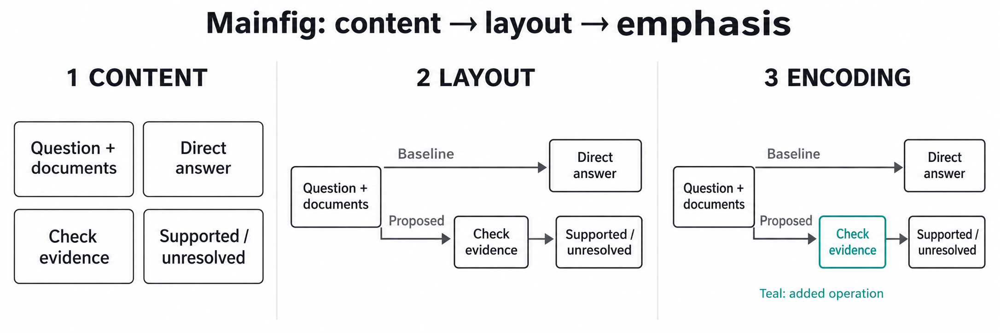

同一假设设计分三步：列内容、对齐路线、突出改动。此图只展示流程，不报告实际提升。

1. **观察 1：**Stage 1 用四张卡片列材料。Stage 2 两行共享输入，对齐改动位置。Stage 3 保持连线不变，只给证据核对步骤加色。

[示意图生成提示词（内置 imagegen）](../assets/figure-stage-prompts.json)

StarPaper 原创 AI 生成教学示意 · 非实测结果 · CC BY 4.0

[图表通用规范与绘图 skill](#figures) · [更多参考绘图](#figure-appendix)

<a id="annotated-intro"></a>

#### 领域与任务模板

从领域价值写到具体任务与能力需求。

**English 填空模板**

[Research area] supports [concrete application or research goal]. In [target scenario], [the system or researcher] must [specific task] using [available inputs]. Successful [task] requires [capability A] and [capability B], motivating research on [the problem studied here].


**高亮与旁批**

1. **[Research area] supports [concrete application or research goal].**：领域价值。填具体应用或研究用途。说明为何研究这个方向。
2. **In [target scenario], [the system or researcher] must [specific task] using [available inputs].**：落到研究任务。填场景、执行者、动作与输入。将背景收束到本文任务。
3. **Successful [task] requires [capability A] and [capability B], motivating research on [the problem studied here].**：建立判断标准。填任务必需的能力。下段据此比较已有工作。

<a id="annotated-intro-comparison"></a>

#### 已有工作与问题模板

先归类已有能力，再引出本文问题。

**English 填空模板**

To support [the task introduced above], methods in [family A] use [shared mechanism] to achieve [established capability] [supporting citations]. Methods in [family B] address [another relevant need] through [shared mechanism] [supporting citations]. However, these advances have not established [the capability required in the target condition], leaving [the specific research gap].


**高亮与旁批**

1. **To support [the task introduced above], methods in [family A] use [shared mechanism] to achieve [established capability] [supporting citations].**：已有路线 A。接回上段任务。按机制归类，并给能力与引用。
2. **Methods in [family B] address [another relevant need] through [shared mechanism] [supporting citations].**：已有路线 B。补充另一类思路及其能力。类别数量由文献决定。
3. **However, these advances have not established [the capability required in the target condition], leaving [the specific research gap].**：从能力引出不足。针对上述能力指出不足。下段解释具体成因与后果。

<a id="annotated-intro-obstacles"></a>

#### 局限与研究必要性模板

写清各项局限的成因及实际妨碍。

**English 填空模板**

Achieving [the established research goal] remains difficult for two reasons. First, ***[limitation A]*** arises because [specific cause or missing capability]. This prevents [the concrete operation or evaluation needed for the goal]. Second, ***[limitation B]*** occurs when [relevant condition], making [another required operation] difficult. Together, these limitations prevent [the precise objective this paper will address].


**高亮与旁批**

1. **Achieving [the established research goal] remains difficult for two reasons.**：段首钩子。接回上一段目标，再解释困难。问题数量按实际调整。
2. **First, [limitation A] arises because [specific cause or missing capability]. This prevents [the concrete operation or evaluation needed for the goal].**：局限 A：成因与后果。先命名困难，再写成因与后果。不能只给属性标签。
3. **Second, [limitation B] occurs when [relevant condition], making [another required operation] difficult.**：局限 B：独立问题。填另一独立问题。写清发生条件及受阻任务。
4. **Together, these limitations prevent [the precise objective this paper will address].**：承上启下。说明局限如何阻碍研究目标。为下一段设计作铺垫。

<a id="annotated-intro-design"></a>

#### 设计与贡献总述模板

先报产物，再逐项解释设计如何解决局限。

**English 填空模板**

To address these limitations, we introduce *[Method]*, a [concrete artifact with its core design and purpose]. For [same limitation A], we [design A], which [verb phrase explaining how A resolves the limitation]. For [same limitation B], we [design B], allowing [the required operation]. [Key contribution object] is constructed from [verified source or selection rule] to [specific use]. Together, these designs enable [the task established in the preceding paragraph].


**高亮与旁批**

1. **To address these limitations, we introduce [Method], a [concrete artifact with its core design and purpose].**：承接问题，点明贡献。开头接回上一段 A、B。方法名后立即写产物与用途。
2. **For [same limitation A], we [design A], which [verb phrase explaining how A resolves the limitation].**：A 对应设计 A。复用 A 的名称，写解法与作用。实现细节留到 Method。
3. **For [same limitation B], we [design B], allowing [the required operation].**：B 对应设计 B。复用 B 的名称，写对应解法。与上一项设计区分清楚。
4. **[Key contribution object] is constructed from [verified source or selection rule] to [specific use].**：关键产物先出现。先写关键产物。再交代来源、筛选依据与用途。
5. **Together, these designs enable [the task established in the preceding paragraph].**：收束到目标。回到上一段研究目标。说明各设计如何共同完成它。

<a id="annotated-intro-findings"></a>

#### 实验发现模板

先概述发现，再给数字与分析，回答研究问题。

**English 填空模板**

To answer [the research question introduced above], we evaluate [Method or evaluated systems] on [datasets or tasks] against [comparison scope]. The experiments reveal [one-sentence overview of the main finding]. Specifically, [verified quantitative result with its comparator and unit]. Further analysis shows [which design or condition is associated with the observed outcome], supporting [the corresponding motivation or claim].


**高亮与旁批**

1. **To answer [the research question introduced above], we evaluate [Method or evaluated systems] on [datasets or tasks] against [comparison scope].**：实验钩子与范围。先接研究问题。再交代评什么、在哪评、和谁比。
2. **The experiments reveal [one-sentence overview of the main finding].**：先给发现总览。用一句话概括核心发现。后面的数字与分析支撑它。
3. **Specifically, [verified quantitative result with its comparator and unit].**：再给亮眼数字。填支持总览的关键结果。写清对照、单位与范围。
4. **Further analysis shows [which design or condition is associated with the observed outcome], supporting [the corresponding motivation or claim].**：最后解释发现。回扣研究动机，解释设计价值。只概述正文已有分析。

<a id="template-intro-contributions"></a>
<a id="draft-contribution-format"></a>
#### 贡献列表模板

用 3 条收束引言：整体工作、关键设计或证据、实验发现。第 2 条按类型选 propose 或 provide。正式方法名用 textit，普通描述不斜体。

- 先用连贯段落说明核心工作、对应设计与实验发现。方法名后的同位语立即点明亮点与用途。不要先堆流程，再讲贡献。
- 【铁律】正文引导句后接原生 itemize，固定三项。依次写整体工作、设计或证据贡献、实验发现。列表后直接进入下一节。
- 方法论文第 2 项写新机制与用途。基准论文写构建或评价设计。实证研究写比较、测量或分析贡献。只写已完成的工作。
- 三项贡献是本套 CS 约定，不是所有会议的规定。论文类型与当轮要求优先。先删重复背景与次要流程，不改模板规避页数。
- 只填真实贡献，不虚构机制或诊断。已讲清的问题与解法无需重复局限标签。

```latex
Our contributions are summarized as follows:
\begin{itemize}
  \item We introduce [work and its type], which [supports the target task through its core contribution].
  \item We [propose or provide] [key design or evidence contribution] based on [verified basis], enabling [specific function or comparison].
  \item Our evaluation on [scope] reveals [key finding], with [the most informative verified evidence].
\end{itemize}
```

<a id="intro-writing-templates"></a>
#### 引言写作模板

按主要贡献选一套，不拼接四套。前两段可合并或交错。贡献固定三项：整体工作、设计或证据、实验发现。

<a id="intro-template-method"></a>
<details><summary>方法型引言</summary>

核心贡献是新方法或新的系统设计。

**领域与研究问题**

[research area] aims to [goal] by mapping [input] to [output]. Recent [approach family] can [supported capability] [citations]. These capabilities support [application], where [task requirement] matters for [practical objective]. This requirement motivates [research question].

先写研究对象、已有能力与任务要求，再引出问题。背景与文献回顾可穿插。

**比较依据与局限**

Existing [approach family A] uses [input A] to [supported operation A] [citations], whereas [approach family B] relies on [input B] to [supported operation B] [citations]. However, [specific limitation] restricts [required capability] because [documented cause or operating assumption]. Under [relevant condition], this restriction leads to [observable consequence]. Addressing it requires [corresponding design requirement].

按同一维度比较，用 However 点出局限及其后果。下一段紧接解法。

**对应设计与贡献**

To address these limitations, we propose \textit{[method name]}, a [verified distinguishing design and purpose]. For [specific limitation], we [concrete design action and contribution] to meet [corresponding design requirement]. It takes [input] and produces [output] through [high-level mechanism]. For [another established limitation, if present], we [next design action] using [preceding output] to [corresponding purpose]. Together, these designs enable [supported capability] under [stated conditions].

【铁律】方法名后立即写亮点与用途。钩子复用前文局限，紧接对应动作。设计及正面修饰须能从来源、操作或结果核查。

**实验概述与结论边界**

To answer [research question], we compare \textit{[method name]} with [appropriate baselines] under [shared evaluation conditions]. Experiments show [verified main finding] on [metric or measured outcome] within [tested scope]. To examine [design motivation], [ablation or controlled comparison] tests [specific design choice] and shows [verified design finding]. Further analysis identifies [supported pattern or remaining limitation], indicating [bounded answer to the original question].

先概述发现，再展开设计检验与分析。各章发现与范围一致，不预填最优或显著提升。

**贡献总结**

```latex
In summary, our contributions are:
\begin{itemize}
    \item We introduce \textit{[method name]}, which [performs the target task through the core components].
    \item We propose \textit{[new mechanism]} based on [verified basis], enabling [specific function] and [actual application].
    \item Evaluation on [tested scope] reveals [key experimental finding], supported by [the most informative verified comparison].
\end{itemize}
```

依次写方法、关键机制与实验证据。第 2 项点名设计及用途，无需复述流程。

</details>

<a id="intro-template-benchmark"></a>
<details><summary>基准与数据集型引言</summary>

核心贡献是新的数据集、基准或评价协议。

**能力与评价问题**

Progress in [research area] enables [supported capability] [citations]. These capabilities support [application], where [condition relevant to the task] affects [required behavior]. Evaluating this behavior requires [observable input or evaluation property]. This requirement raises [research question].

先说明为何评价该能力。问题落到可观察的输入、行为或结果。

**已有基准与评价缺口**

Existing [benchmark family A] measures [evaluation target A] using [reported inputs and criteria] [citations]. [benchmark family B] instead evaluates [evaluation target B] under [reported setting] [citations]. However, [specific evaluation limitation] limits evaluation of [specific required capability], as shown by [evidence-bounded comparison]. [required input or criterion] is needed to distinguish [behavior of interest] from [alternative behavior], so [corresponding evaluation design] is necessary.

按输入、判据与目标比较，区分缺失、未报告和未公开。说明缺口导致哪种行为无法区分。

**建设障碍与设计要求**

However, establishing [required evaluation] faces [self-explanatory construction obstacle]. [documented source or annotation constraint] makes [required construction step] difficult. In addition, [another independent obstacle, if present] limits [another necessary step] because [documented reason]. Addressing these obstacles is necessary to obtain [usable evaluation artifact] for [research question].

建设困难与已有评价缺口分开写。逐项写受阻步骤及后果，无独立第二项则删去。必要时与前段合并。

**数据、判据与核心贡献**

To address these limitations, we propose \textit{[benchmark or dataset name]}, a [verified source or distinguishing design] for [evaluation purpose]. For [data construction obstacle], we construct [data contribution] from [verified source] using [documented selection or collection rule]. For [specific evaluation limitation], we [evaluation contribution and action] to measure [capability linked to the earlier gap]. The tested system receives [task input], while [evaluation evidence or criteria] is used by [evaluator] to assess [system output]. These components support [supported evaluation capability] within [coverage boundary].

【铁律】先报产物，再写来源与构建依据。钩子复用评价局限，数据与判据各回应对应困难。受测输入与评分材料分开。

**基准结果与研究发现**

To answer [research question], we evaluate [systems or model families] using [shared protocol]. Results reveal [verified main finding] within [tested scope]. Specifically, [named finding, if useful] describes [observed behavior or result contrast]. To examine [observed limitation], [diagnostic analysis] shows [supported diagnostic finding]. These results indicate [bounded implication] and leave [remaining question] unresolved.

先给发现，再解释命名现象的含义。诊断回答原问题，不扩大为未验证的机制。

**贡献总结**

```latex
In summary, our contributions are:
\begin{itemize}
    \item We introduce \textit{[benchmark or dataset name]}, which supports [evaluation task] with [verified coverage and core components].
    \item We propose [construction or evaluation design] based on [verified source or principle] to [address the specific evaluation difficulty].
    \item Evaluation of [systems or model families] under [shared protocol] reveals [key quantitative finding and its scope].
\end{itemize}
```

依次写基准或数据集、构建或评价设计、测评发现。规模不等于全部贡献。

</details>

<a id="intro-template-diagnostic"></a>
<details><summary>诊断驱动的改进研究引言</summary>

先诊断瓶颈，再提出改进。正文依次写 Diagnostic Analysis、Method 与验证。

**已有能力判断与可检验问题**

[research area] seeks to [goal]. Existing [approach family] achieves [supported result] under [reported conditions] [citations]. However, it remains unclear whether this result demonstrates [target capability]. If the capability holds, [testable expectation] should be satisfied under [controlled condition].

区分已有成绩与被宣称的能力。用 However 提出可检验质疑，不硬套段数。

**诊断设计与关键发现**

To test this expectation, we construct [diagnostic comparison] by changing [target condition] while preserving [relevant controls]. The comparison reveals [verified diagnostic finding]. Further [discriminating control or process analysis] shows [supported bottleneck evidence], suggesting that [bounded interpretation]. These observations motivate [design requirement].

先写诊断，再写方法。交代改变与保留条件，由发现定位有据瓶颈。

**针对瓶颈的设计**

To address these limitations, we propose \textit{[method name]}, a [distinguishing design and purpose]. For [diagnosed bottleneck], we [concrete design action] to [corresponding role]. For [another established bottleneck, if present], we [next design action] using [preceding output] to [corresponding role]. [training or execution procedure] combines these components to produce [output].

动作靠前，每项设计回应诊断。无独立第二项则删去；训练或推理按实际写。

**回到诊断的改进验证**

To answer [original capability question], we evaluate \textit{[method name]} on [main task] and repeat [original diagnostic comparison]. Results show [verified main finding] and [verified finding under diagnostic conditions]. Further [process analysis or controlled ablation] examines [design motivation] and yields [verified result]. Together, these tests support [bounded conclusion] within [tested scope].

先概述发现，再给主任务、诊断复测及过程检验证据。各项回答最初的能力质疑。

**贡献总结**

```latex
In summary, our contributions are:
\begin{itemize}
    \item We investigate [target capability] through [diagnostic study], identifying [evidence-supported bottleneck] under [tested conditions].
    \item We propose \textit{[method name]} with [core design] to address [the diagnosed bottleneck].
    \item Evaluation on [main-task scope] and [diagnostic comparison] shows [the verified improvement or trade-off], answering [the original capability question].
\end{itemize}
```

依次写诊断认识、针对瓶颈的设计、主任务与诊断复测结果。

</details>

<a id="intro-template-empirical"></a>
<details><summary>实证发现型引言</summary>

核心贡献是新的经验规律、系统比较或对既有解释的检验。

**现象与研究问题**

Understanding [research phenomenon] matters for [scientific or practical objective]. Prior [research route] establishes [supported finding] within [previously studied scope] [citations]. This evidence motivates [specific question about the phenomenon]. Answering this question requires distinguishing [competing possibilities] under [relevant condition].

分清已知事实与未答问题，点明需要区分什么。可与文献回顾合并。

**已有证据与检验缺口**

Existing studies examine [relationship or behavior] using [reported design] [citations]. They provide evidence for [supported interpretation] under [documented assumptions or scope]. However, [specific evidence limitation] prevents these results from resolving [research question]. A comparison that [required contrast or measurement] is needed to distinguish [explanation A] from [explanation B].

点出证据缺口，紧接检验要求。未测试不等于失败，相关不等于因果。

**研究设计与可检验贡献**

To address these limitations, we propose [study or analysis], a [verified distinguishing design] for testing [research question]. For [specific evidence limitation], we [core comparison or measurement]. We compare [groups or conditions] that differ in [examined factor], using [documented control or adjustment] to examine [alternative explanation]. [measurement or analysis contribution] measures [observable outcome] using [verified data or procedure]. This design estimates [precise quantity or relationship] within [study population and conditions].

【铁律】钩子点名证据缺口，贡献落到比较或测量。受控实验写改变因素。观察研究写自然差异、调整及估计对象。调整不等于排除全部解释。

**主要发现与解释范围**

To answer [research question], we analyze [evidence] under [reported study conditions]. The results show [verified main relationship or contrast]. Further [robustness check or independent analysis] examines [specific alternative explanation] and yields [verified result]. These findings support [evidence-bounded interpretation] within [tested scope], while [unresolved limitation] restricts [claim or generalization].

先陈述发现，再说排除及未排除的解释。主结果与稳健性各有对象，回答同一问题。

**贡献总结**

```latex
In summary, our contributions are:
\begin{itemize}
    \item We present a systematic study of [research question] using [data and study design].
    \item We provide [controlled comparisons, measurements, or an analysis protocol] that distinguish [the competing possibilities examined in this study].
    \item Our analysis reveals [key empirical finding] within [studied scope], supported by [the most informative verified contrast or robustness result].
\end{itemize}
```

依次写问题与范围、比较或测量证据、经验发现。没有新机制则不声称提出新机制。

</details>

<a id="intro-hooks"></a>
#### 段落承接

钩子接回前文问题或产物。局限 A、B 各有对应设计，再由实验检验。各章沿用同一组关键词。


<a id="abstract-intro-map"></a>
#### 摘要与引言：主张对应

摘要压缩问题、贡献与发现，引言展开依据与作用。箭头连接同一主张，不规定段数。


**问题 · 同一问题，展开背景与局限**

**Abstract**：[Task] requires [capability]. Existing approaches face [limitation A] and [limitation B], which restrict [research objective].

**Intro**：[Prior work] provides [known capability]. However, [limitation A] arises when [condition A], while [limitation B] prevents [required operation]. Together, these limitations restrict [research objective].
 · [查看对应关系](#intro-map-question)

**贡献 · 同一贡献，展开设计作用**

**Abstract**：For [limitation A], we [design A and purpose]. For [limitation B], we [design B and purpose].

**Intro**：To address these limitations, we introduce [Method], a [core design and purpose]. For [limitation A], we [design A and purpose] using [the relevant input or evidence]. For [limitation B], we [design B and purpose].
 · [查看对应关系](#intro-map-design)

**发现 · 同一发现，展开证据与含义**

**Abstract**：On [tested scope], [Method] achieves [key value] on [metric], compared with [baseline value]. Further analysis reveals [key experimental finding].

**Intro**：To answer [research question], we evaluate [objects] under [conditions]. [Key comparison and numerical result] supports [main conclusion]. Further analysis reveals [key experimental finding], explaining [the aspect examined by the analysis].
 · [查看对应关系](#intro-map-findings)

<a id="intro-body-map"></a>
#### 引言如何贯穿全文

引言提出问题。相关工作给依据，方法给设计，实验给检验。讨论与结论说明意义和范围。

方括号填同一组对象。同色高亮与箭头表示对应关系。句数、段数与局限数量不固定。

- **Q · 研究问题：**全文回答同一问题。

- **L → M → E · 局限、设计与检验：**哪项设计处理哪项已有不足？用什么证据检验？

- **D · 实施困难：**实施本文研究的困难。必要时单独展开。

- **B · 本文剩余局限：**说明本文解决到哪一步。与前人局限 L 分开。

**A · 背景与已有研究**

[已有研究]已说明[已知能力或发现]。这些结果支持[应用目标或进一步研究]。

句首钩子：`These findings motivate [the research question].`

- 相关工作 · 核实已有起点：写清[已有路线]的实际能力、输入和适用条件。附原论文依据。
- 方法 · 区分已有与新增：说明哪些能力来自已有方法，本文新增了什么设计。

承认并引用已有能力。不把它们写成本文贡献。

**Q · 研究问题**

[研究背景或实践需求]提出[具体研究问题 Q]。

句首钩子：`To answer [the specific research question], we ...`

- 方法 · 任务定义 · 定义对象与目标：将 Q 对应到[研究对象]与[任务定义或变量关系]。给出[可观测量]。系统任务再写输入、输出与约束。
- 实验 · 研究问题 · 给出检验方式：用[数据与比较条件]和[对应指标]检验 Q。
- 结论 · 回答开头：依据实际结果，在[已研究条件]内回答 Q。

任务、指标与结论针对同一对象和能力。代理指标改善，不代表未经测量的应用收益。

**L1 → M1 → E1 · 已有局限与对应解法**

However, [已有路线]在[具体范围]存在[局限 L1]，因而妨碍[目标 Q]。For [局限 L1], we [设计 M1 的具体动作].

句首钩子：`For [limitation L1], we [specific design action].`

- 相关工作 · 主题收尾 · 给 L1 比较依据：However, [L1：现有路线在具体条件下无法完成什么及其后果]. To address this gap, we [实际动作] [对象] based on [真实原则]. This enables [实际应用], [有依据的 -ing 动词] [前述同一问题].
- 方法 · M1 · 解释为什么这样设计：[M1]针对 L1 的哪项原因？采取什么操作？产物供后续怎样使用？
- 实验 · E1 · 检验原动机：用[能检验 M1 作用的对照 E1]检查[与 L1 对应的指标或行为]。

三处沿用同一局限名称与比较范围。“未报告”不写成“没有”。整体系统对比不能证明单项设计的收益。

**L2 → M2 → E2 · 另一项独立局限（按需）**

此外，[独立局限 L2]影响[另一必要能力]。For [独立局限 L2], we [设计 M2 的具体动作].

句首钩子：`For [limitation L2], we [specific design action].`

- 相关工作 · 另一主题 · 说明 L2 有何不同：给 L2 的依据，紧接 M2。不要换词重复 L1。
- 方法 · M2 · 交代独立作用：说明 M2 使用什么输入，怎样满足[与 L2 对应的要求]。
- 实验 · E2 · 给对应检验：E2 检验[与 L2 对应的能力]。结果段沿用同一问题，解释实际发现。

有独立不足才增加此项。不为凑“两项局限”重复问题。

**D · 实施困难（按需）**

[实施困难 D]限制[研究任务]。这会阻碍[必要步骤]。

句首钩子：`Establishing [the required artifact] requires [specific step].`

- 方法 · 构建或研究设计 · 给可执行解法：说明实际来源、选择规则、操作与产物怎样处理 D。
- 附录 · 补可复核材料：提供[与 D 的解法对应的协议、配置或材料]，并从正文定位。

D 是实施困难，L 是前人局限，两者不同。如实交代来源与权限等影响判断的信息。

**M · 核心设计与贡献**

To address these limitations, we propose [name], a [核心亮点与用途]。For [同名局限], we [核心设计的具体动作].

句首钩子：`For [named limitation], we [concrete contribution].`

- 方法 · Overview · 展开贡献与依赖：先说核心思想与每项设计的作用。再概括各节输入、操作与输出。
- 框架图与图注 · 显示同一操作关系：图中对象、名称与方向须与正文一致。按实际画串行、并行或反馈。
- 实验 · 设置与设计检验 · 固定能判断作用的条件：比较条件须对应[要检验的设计作用]。说明固定项与无法对齐的差异。

引言点明贡献，方法解释实现，实验提供检验。产物、流程与效果分别写清。

**E → Q · 主要发现**

To answer [Q], we evaluate [研究对象] under [条件]。实验发现[主要结论 E]，回答了[Q 的哪一部分]。

句首钩子：`To examine [the motivated capability], we compare [objects].`

- 实验 · 主结果与分析 · 先结论，再证据：报告 E 对应的关键比较、图表、指标口径和不确定性。
- 实验 · 回扣动机 · 解释回答了什么：说明 E 是否支持[原设计目标]。改善、无支持或失败，均回答同一问题。
- 摘要与引言 · 压缩同一发现：摘要压缩 E，引言概述 E。名称、数值、对象和范围与实验一致。
- 讨论 · 限定解释：区分观察到的差异、可能原因与已验证机制。

实验结论回应最初动机。无受控检验，不作因果归因。案例不代替总体频率。

**C / B · 贡献与结论范围**

本文提供[新增贡献 C]，揭示[实际发现]。结论限于[已验证范围]。仍有[本文剩余局限 B]。

句首钩子：`Within [the evaluated conditions], [supported conclusion].`

- 讨论与局限 · 解释 B 的影响：说明[未覆盖条件或假设 B]怎样限制结论。未测试不等于已失败。
- 结论 · 闭合 Q：回答 Q，概括已验证的贡献与发现，保留同一范围。
- 摘要与引言 · 反向校准主张：证据只支持[有限范围]时，主张都缩至该范围。包括摘要、引言与贡献句。

L 是前人不足，B 是本文边界。限制核心主张的 B 须随该主张说明。不必将全部局限塞进引言。

L1 → M1 → E1 → Q：[具体局限] → [对应设计] → [设计作用的检验] → [对研究问题的回答]。

其他主张：数据质量、效率、泛化或机制也需对应证据。按实际贡献补充，不能只重复钩子。

**结果回写**：实际发现及范围 → 摘要、引言 → 讨论与结论。结果或证据范围改变，对应主张也须更新。

<a id="related"></a>
<a id="chapter-related"></a>
### 2.5 相关工作

按主题回顾已有工作，段末依次写局限、本文做法和应用。

#### 本节原则

- 按任务、机制或评价目标分主题，标题独占一行。主题内先归类能力，再比较缺口。
- 【铁律】每段末 3 句固定，顺序不能交换。However 写局限，we 写做法，This enables 写应用与作用。
- 【铁律】段末局限与引言对应。区分做法、应用及解决的问题。相邻主题处理不同不足。
- 引用紧跟判断，承认已有能力。未报告不等于不存在，未比较不等于失败。

<a id="annotated-related"></a>

#### 相关工作主题段模板

每段依次写：已有工作、局限、做法、应用。

**English 填空模板**

[Research topic] studies [task or goal]. Methods in [family A] use [mechanism A] to [established capability A] [citations]. Methods in [family B] support [different capability B] through [mechanism B] [citations]. However, [a complete clause stating the limitation and its consequence]. To address this gap, we [action] [research object] based on [method or principle]. This enables [actual application], [evidence-supported -ing verb] [the same problem stated in the gap].


**高亮与旁批**

1. **[Research topic] studies [task or goal].**：小节主题。填本组工作的任务或机制。主题标题另起一行。
2. **Methods in [family A] use [mechanism A] to [established capability A] [citations]. Methods in [family B] support [different capability B] through [mechanism B] [citations].**：归类回顾。归类写已有能力与共同思路。引用紧跟判断。
3. **However, [a complete clause stating the limitation and its consequence].**：倒数第三句：局限。However 后写完整判断。说明谁在什么条件下做不到什么。再写这会妨碍哪个目标。
4. **To address this gap, we [action] [research object] based on [method or principle].**：倒数第二句：做法。主语用 we，填动作、对象与依据。做法直接回应上一句局限。
5. **This enables [actual application], [evidence-supported -ing verb] [the same problem stated in the gap].**：末句：应用与作用。前半句填支持的任务。后半句用 -ing 接回同一问题。动词强度取决于证据。

<a id="method"></a>
<a id="chapter-method"></a>
### 2.6 方法

先解释设计为什么有用，再用输入、操作和输出展开。

#### 本节原则

- 先定义任务，再给总览，随后按依赖介绍模块。每个模块写目的、设计依据、输入与输出。
- 【铁律】模块首句用 To [具体目的], [执行者] [设计或动作]。承接引言对应问题，不能只说“提高质量”。
- 【铁律】Overview 用准确章节名与节号，每小节只引一次。写清操作与产物交接，末句指向框架图。串行、并行和反馈按实际关系写。
- 【铁律】任务定义、框架图、总览及模块使用同一套名称。输入输出一致，各阶段可见信息分清。
- 【铁律】符号先解释对象、来源、单位与下标，再使用。必要公式单独编号，并保留标点。普通操作不强造公式。
- 重点解释自己的设计，外部组件说明来源与职责。参数作用写 Method；取值、选择规则及版本写实现细节。

<a id="annotated-method-task"></a>

#### 任务定义

定义输入、输出与任务完成标准。

**English 填空模板**

Given [input objects and their sources], the task is to produce [output object] that satisfies [task requirements]. We denote [essential object] by [symbol] and define [the decision or objective]. During [training or inference], [system] has access to [available information]. [Evaluation-only information, if any] is used only for [evaluation role].


**高亮与旁批**

1. **Given [input objects and their sources]**：先给输入。填实际输入及来源。后续输出必须由这些输入得到。
2. **[output object] that satisfies [task requirements]**：输出与任务要求。填输出形式与判断标准。供后续模块和指标使用。
3. **We denote [essential object] by [symbol] and define [the decision or objective].**：必要符号。先解释对象，再定义符号。模块公式放对应小节。
4. **During [training or inference], [system] has access to [available information]. [Evaluation-only information, if any] is used only for [evaluation role].**：各阶段可见信息。分清训练、推理与评价的信息。评价答案不能充当模型输入。不存在的阶段删去。

<a id="annotated-method-overview-teaching"></a>

#### 方法总览

概括模块职责、输入输出与所在小节。

**English 填空模板**

To address [Introduction limitation A], in [exact subsection A title] (Section [A]), we [design action] using [input] to obtain [intermediate output]. To address [Introduction limitation B], in [exact subsection B title] (Section [B]), we [next action] using this [intermediate output] and [additional input]. This step produces [output of module B]. Finally, in [exact subsection C title] (Section [C]), [actual executor] transforms this [output of module B] into [final output] for [task objective]. Figure [framework] summarizes these dependencies.


**高亮与旁批**

1. **To address [Introduction limitation A]**：接回引言问题。填引言已建立的局限。说明为何需要这项设计。
2. **in [exact subsection A title] (Section [A]), we [design action] using [input] to obtain [intermediate output]**：一句概括一个小节。填节名、节号、执行者与操作。写清接收什么、产出什么。
3. **we [next action] using this [intermediate output] and [additional input]. This step produces [output of module B].**：交接实际产物。串行模块交接实际产物。并行模块分别写输入与汇合点。
4. **transforms this [output of module B] into [final output] for [task objective]**：收束到任务目标。末个模块给最终输出。模块数量按真实结构增删。
5. **Figure [framework] summarizes these dependencies.**：图文结构一致。框架图、总览与小节同名。三处使用相同依赖关系。

<a id="figure-framework"></a>
#### Framework：方法框架图

对应 Method Overview，解释设计如何解决引言的困难。再展示输入、关键操作、中间产物与输出。

##### Stage 1 · 写清输入、操作与产物

- 每个模块写清输入、操作、产物与接收者。名称与 Method 小节一致。产物注明对象，不只叫 Features 或 Results。
- 将引言的困难对应到解决它的模块。先说明设计为何必要，再补实现细节。
- 【铁律】箭头对应真实依赖，训练、推理与评价分开。评价专用的答案与判据，不连到被测模型输入。

##### Stage 2 · 按依赖排模块

- 先定唯一主阅读方向，再排模块。同层内容成组并命名，并行分支保持并行。汇合点写明收到的产物。
- 相邻模块用短连线，箭头不穿文字。反馈放在主流程旁，注明触发条件。不为排版添加虚构的串行或反馈。
- 用一个案例串起关键模块。就近展示输入片段、中间产物和输出。不用模块名替代实际材料。

##### Stage 3 · 编码角色并逐箭头核对

- 三种边框区分输入、输出与评价材料，图例解释含义。解决关键困难的模块用统一强调色。
- 材料、操作模块和评价器旁写对象名。大框对应 Overview，内部步骤对应方法小节。同名同义。
- 逐条读箭头：“谁把什么交给谁”。再查案例来源、简称、颜色与实际字号。读不通的连接先修内容。

<a id="teaching-framework-stages"></a>
#### 示范：依赖、分区与材料角色

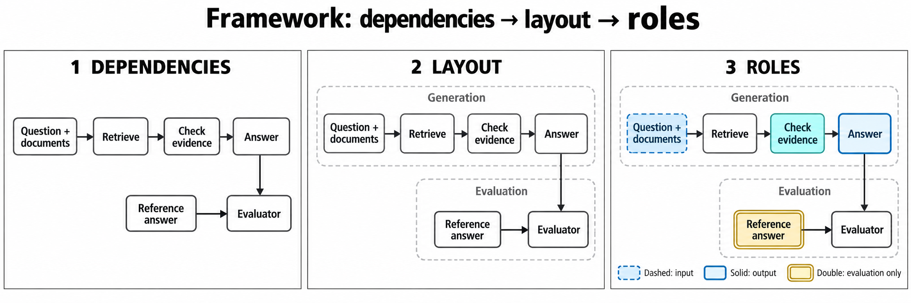

先核对依赖，再分开生成与评价，最后区分材料角色。参考答案始终只送入评价器。

1. **观察 1：**此图只演示排版，正式图须在连线旁标产物。检索产出候选证据，核对产出支持的主张或待确认项。生成产出回答。蓝虚框表示输入，蓝实框表示输出。金色双线框表示评价专用材料。灰虚框只作分区，无色框表示操作。

[示意图生成提示词（内置 imagegen）](../assets/figure-stage-prompts.json)

StarPaper 原创 AI 生成教学示意 · 非实测结果 · CC BY 4.0

[图表通用规范与绘图 skill](#figures) · [更多参考绘图](#figure-appendix)

<a id="annotated-method-module"></a>

#### 方法模块

每个模块写：目的、依据、操作、输出。

**English 填空模板**

To [solve the specific problem assigned to this module], we [key design action]. This design addresses [the specific insufficiency of the input or existing operation] by [the mechanism that meets the requirement]. Given [actual module input], [executor] performs [necessary operation] according to [criterion or equation]. The operation produces [output representation and relevant fields], which [next module] uses to [next purpose].


**高亮与旁批**

1. **To [solve the specific problem assigned to this module], we [key design action].**：首句：目的与设计。填该模块要解决的具体问题。紧接相应设计或动作。
2. **This design addresses [the specific insufficiency of the input or existing operation] by [the mechanism that meets the requirement].**：解释为什么这样做。填设计针对的缺陷与作用机制。解释设计依据，不能只列步骤。
3. **Given [actual module input], [executor] performs [necessary operation] according to [criterion or equation].**：说明如何执行。补充复现所需的操作与条件。外部组件注明名称和来源。
4. **[output representation and relevant fields], which [next module] uses to [next purpose]**：末句交接产物。写产物交给谁、用于什么。末个模块说明最终输出。参数数值放实现细节。

<a id="experiments"></a>
<a id="chapter-experiments"></a>
### 2.7 实验

说明比较怎样做，再报告发现、关键证据和分析。

<a id="refine-attribution-comic"></a>


多个因素同时变化，不能只归因于一个。主结果也不能证明每个模块各自有效。

#### 本节原则

- 依次写：概述、设置、指标、主结果、消融、补充分析。每项分析回答引言中的一个问题。RQ 可编号，也可写进标题或首句。
- 章首先承接方法或数据，概述对象与主发现。再引出分析；名单、设置与结果分开写。
- 【铁律】Metrics 用一个紧凑自然段。先写目标，再按 1)、2)、3) 定义指标。名称只加粗，不斜体。写清定义、方向、单位、分母与汇总。交代无效输出处理。
- 结果段先给发现，再给图表、对照与关键数字。最后回答引言中的问题，说明代价与例外。
- 逐模块写消融。Setting 定义变体及共享条件，Results 分析对应结果。设置、表格与分析中的变体同名。
- 【铁律】均值与不确定性来自真实观测和明确方法。说明统计或重采样单位、数量及 SD、SE 或 CI。单次运行不能声称跨运行稳定。
- 【铁律】数据版本、范围、配置与结果对应同一协议。缺失、无效、不适用分别交代。不得只保留成功输出。
- Case Study 展示输入、中间产物与输出，解释关键设计。区分实测与构造案例，个例不能替代核心验证。

<a id="annotated-experiments-overview"></a>

#### 实验概述

承接方法，概述发现，再预告验证与分析。

**English 填空模板**

After constructing [method, dataset, or benchmark], we evaluate [target systems or behaviors] on [evaluation scope]. The results show [verified main finding that answers the Introduction question]. Specifically, we compare [method or systems] with [comparison group] to examine [primary claim]. We then analyze [component role or remaining question] through [actual ablation, diagnosis, or further test].


**高亮与旁批**

1. **After constructing [method, dataset, or benchmark]**：接回前章产物。接回已介绍的方法或数据。点明受测对象。
2. **The results show [verified main finding that answers the Introduction question].**：先概述主发现。填最重要的实验发现。与摘要和引言一致。
3. **to examine [primary claim]**：主实验回答核心主张。说明各项贡献如何检验。RQ 可编号，也可直接写入句中。
4. **through [actual ablation, diagnosis, or further test]**：预告后续分析。填实际开展的后续分析。分别交代它们回答什么问题。

<a id="annotated-experiments-datasets"></a>

#### 数据与划分

定义实验总体、样本单位与数据范围。

**English 填空模板**

**Datasets.** We evaluate on [dataset names, versions, and citations], which contain [sample unit and task-relevant coverage]. We use [training, development, and test split or official evaluation protocol]. [Parameters or model choices] are selected using [development data], while [test split] is reserved for final evaluation. [Inclusion rules and resulting sample counts] define the evaluated population. [Additional preprocessing details] are provided in Appendix [data].


**高亮与旁批**

1. **[dataset names, versions, and citations]**：标识数据版本。名称、版本与引用放在一起。不得混用同名数据的不同划分。
2. **[sample unit and task-relevant coverage]**：说明一条样本是什么。填影响评价的输入、标签或场景。详细统计放数据节或附录。
3. **[training, development, and test split or official evaluation protocol]**：交代真实划分。填实际划分与用途。纯推理可用官方测试集。没有调参则删除选参句。
4. **[Inclusion rules and resulting sample counts] define the evaluated population**：固定统计范围。填纳入规则与有效数量。分别说明排除、不适用和无效输出。

<a id="annotated-experiments-baselines"></a>

#### 比较方法

交代比较对象、选择依据与比较条件。

**English 填空模板**

**Baselines.** We compare [our method] with [baseline family A and citations], which [shared mechanism], and [baseline family B and citations], which [different relevant mechanism]. These baselines cover [comparison dimensions related to our contribution]. All methods use [matched data, model access, resources, or evaluation conditions]. [Unmatched conditions that may affect interpretation] are reported in [settings location].


**高亮与旁批**

1. **[baseline family A and citations], which [shared mechanism]**：按路线介绍比较对象。按路线归类，再简述机制。版本与引用紧跟名称。
2. **[comparison dimensions related to our contribution]**：说明选择依据。选与贡献有关的常用或强对照。覆盖相关近期工作。
3. **[matched data, model access, resources, or evaluation conditions]**：说清比较条件。只写实际控制的条件。预算上限相同不等于信息量相同。
4. **[Unmatched conditions that may affect interpretation]**：保留影响判断的差异。标明公开报告值及其来源。闭源模型、异构硬件等差异须交代。

<a id="annotated-experiments-implementation"></a>

#### 实现细节

集中交代会影响结果的执行设置。

**English 填空模板**

**Implementation Details.** We implement [method] with [backbone or dependency versions]. [Key parameters introduced in Method] are set to [actual values] using [selection procedure and data]. Evaluation uses [execution configuration, hardware, and resource budget relevant to the comparison]. We conduct [actual repeats] over [repeat unit] and report [aggregation and uncertainty definition]. [Evaluator identity, configuration, and assessment protocol, if applicable] are specified in [protocol location].


**高亮与旁批**

1. **[backbone or dependency versions]**：固定执行版本。填实际模型、软件或代码版本。让读者能定位同一实现。
2. **[actual values] using [selection procedure and data]**：补全方法参数。填参数值、搜索范围与选择依据。一次固定的参数也须说明。
3. **[execution configuration, hardware, and resource budget relevant to the comparison]**：写影响结果的条件。填相关训练、推理、检索与解码设置。涉及成本比较时给成本口径。完整配置可放附录。
4. **[actual repeats] over [repeat unit] and report [aggregation and uncertainty definition]**：定义重复与误差。写运行次数、重复单位与统计方法。单次可报告样本统计。不能据此声称跨运行稳定。样本量不是运行次数。
5. **[Evaluator identity, configuration, and assessment protocol, if applicable]**：单独交代评价器。有判分时写谁判什么、依据什么。说明判分如何核验。无评价器则删去。

<a id="annotated-experiments-metrics"></a>

#### 指标定义

一个紧凑自然段：评价目标 → 编号定义各指标。

**English 填空模板**

**Metrics.** We assess [target properties linked to the task] on [evaluation units and scope]. 1) **[Metric 1 full name (abbreviation)]** measures [definition, unit, direction, and denominator]. 2) **[Metric 2 full name (abbreviation)]** measures [definition, unit, direction, and denominator]. 3) **[Metric 3 full name (abbreviation)]** measures [definition, unit, direction, and denominator]. We compute [per-unit quantities] and aggregate them using [macro, micro, weighted, or other actual rule]. [Invalid, missing, and not-applicable outputs] are handled according to [defined policy], with [applicable counts or coverage] reported in [location].


**高亮与旁批**

1. **We assess [target properties linked to the task] on [evaluation units and scope].**：先说明衡量什么。填指标衡量的任务或贡献。紧接评价单位与范围。
2. **1) [Metric 1 full name (abbreviation)] measures [definition, unit, direction, and denominator].**：编号与指标定义。首次给全称与缩写。名称只加粗，不斜体。指标数量按实际增删。
3. **We compute [per-unit quantities] and aggregate them using [macro, micro, weighted, or other actual rule].**：说明如何汇总。写先按什么单位计算。再写如何汇总。自定义公式与判据给附录入口。
4. **[Invalid, missing, and not-applicable outputs] are handled according to [defined policy]**：交代异常处理。区分失败、缺失与不适用。按协议处理，并报告覆盖范围。不得静默删样本。

<a id="figure-experiments"></a>
#### 实验绘图

一图回答一个实验问题。Python 等工具从真实记录绘图，美化不改变实验。

##### Stage 1 · 确定比较与统计口径

- 先列比较对象、指标、单位、样本量和有效子集。注明统计方法，从原始记录计算。不让绘图工具猜分母或缺测。
- 少量方法比较用点图或柱图。有序动态用折线，配对变化用差值。分布按需用原始点、箱线图、KDE 或 ECDF。
- 【铁律】保留下降、缺测与已有不确定性。不补点、不编误差、不为平滑改数据。误差线注明 SD、SE 或 CI、统计单位与算法。

##### Stage 2 · 统一坐标与面板

- 可比面板统一方法顺序、坐标尺度和图例映射。坐标写明变量、单位和好坏方向。图例放空白处，不遮关键点。
- 柱长表示数量时，坐标从零起。确需截断时须注明，不能按柱高读倍数。差值图标零线，无序方法不连成趋势。
- 少量观测显示原始点，密集重叠先调透明度。仍看不清再用分箱计数，并注明箱宽。不得移动真实坐标制造分离。

##### Stage 3 · 编码组别并核对数值

- 颜色、点形、线型和纹理与方法绑定，跨面板一致。可用强调色突出本文方法，对照方法也须清晰。
- 连续量用顺序色标，区分有意义的基准才用发散色标。同指标的可比面板共用颜色映射与范围。不同指标另标单位和色标。缺测不当零分，KDE 峰高不当人数。
- 按原始数据核对点位、柱高和误差。导出嵌入字体的矢量 PDF。插回论文检查图例、字号与裁切。含位图的 PDF 不称全矢量。

<a id="figure-types"></a>

<a id="teaching-experiment-before-after"></a>
#### 示范：同一数据的排版优化

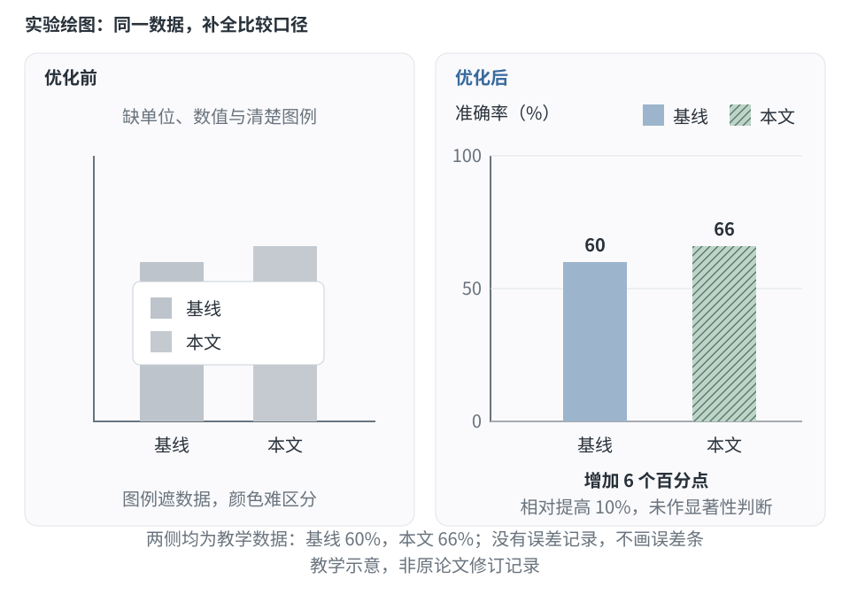

两侧共用 Baseline 60%、Ours 66% 的教学数据。右侧补单位与数值，移开图例，增加纹理。提高 6 个百分点，相对提高 10%。

1. **观察 1：**排版不改柱高与数据。示例只有两个汇总值，缺少估计不确定性的观测和方法。因此不画误差棒；真实实验保留并定义已有不确定性。

StarPaper 原创教学数据与改排，CC BY 4.0；不是论文实验结果。

[图表通用规范与绘图 skill](#figures) · [更多参考绘图](#figure-appendix)

<a id="annotated-experiments-main-teaching"></a>

#### 主要结果

每段依次写：发现、数字、解释、适用范围。

**English 填空模板**

**[Main finding under the tested conditions].** Table [main results] shows that [method] achieves [verified value and unit] on [metric], compared with [baseline value] for [named baseline]. This corresponds to [verified difference with its unit and measured uncertainty, if available] across [actual evaluation scope]. The comparison supports [the Introduction claim answered by this result]. [A relevant exception or measured trade-off, if observed].


**高亮与旁批**

1. **[Main finding under the tested conditions].**：段首先给结论。加粗一句具体发现。不预设所有指标均提升。
2. **[verified value and unit] on [metric], compared with [baseline value] for [named baseline]**：挑有解释力的数字。填决定结论的数值与对照。不要逐行复述表格。
3. **[verified difference with its unit and measured uncertainty, if available]**：把差值写准确。区分百分比与百分点。显著、稳定须有统计证据。
4. **The comparison supports [the Introduction claim answered by this result].**：回扣动机与贡献。回答前文对应的问题。整体优势不能拆作各模块作用。
5. **[A relevant exception or measured trade-off, if observed].**：补充影响结论的取舍。填重要代价或失效条件。没有相关证据则删去。

<a id="experiment-results-table"></a>
#### 主结果表：排版与 LaTeX 模板

排版示例，数值均为假设。上标为标准差，浅红标最优，浅蓝标次优。

| Method | Success (%) ↑ | Latency (ms) ↓ |
| --- | --- | --- |
| Baseline A | 70.0 ±2.0 | 120 ±4 |
| Baseline B | 73.0 ±1.0 | 130 ±4 |
| Proposed method | 76.0 ±1.0 | 125 ±3 |

**LaTeX 表格模板**

```latex
% Add these packages to the preamble if the venue permits them.
\usepackage{booktabs}
\usepackage[table]{xcolor}
\definecolor{bestcell}{HTML}{F2EBEA}
\definecolor{secondcell}{HTML}{EDF0F4}

% Insert this environment in the body.
\begin{table}[!t]
\centering
\caption{Illustrative values only. Success rate is in percent;
latency is in milliseconds. Superscripts illustrate standard deviations.
Best values are bold; second-best values are underlined.}
\label{tab:main-results}
\begin{tabular}{lcc}
\toprule
Method & Success ($\uparrow$) & Latency ($\downarrow$) \\
\midrule
Baseline A & 70.0\textsuperscript{\(\pm2.0\)}
 & \cellcolor{bestcell}\textbf{120}\textsuperscript{\(\pm4\)} \\
Baseline B & \cellcolor{secondcell}\underline{73.0}\textsuperscript{\(\pm1.0\)}
 & 130\textsuperscript{\(\pm4\)} \\
Proposed method & \cellcolor{bestcell}\textbf{76.0}\textsuperscript{\(\pm1.0\)}
 & \cellcolor{secondcell}\underline{125}\textsuperscript{\(\pm3\)} \\
\bottomrule
\end{tabular}
\end{table}
```

先确认会议允许使用这些包。包声明放导言区，table 环境放正文。正式表换成真实数据。表注写统计单位、重复次数、可比范围与主要发现。跨栏用 table*，不改模板栏宽。

<a id="experiments-experiment-ablation-table-template-writing-templates"></a>

<a id="experiment-ablation-table-template"></a>
#### 结果表：变体、指标与标记

先定行列，再填结果。表头分数据集与指标两级，每行对应一种已定义变体。

- 【铁律】单元格内名称、引用、数值及误差保持单行。先调列宽，必要时改通栏。不要靠缩写、折行或整体缩放掩盖拥挤。
- 固定数据集、指标、方向、单位与精度。横向查变体，纵向比指标。
- 多路线用分组行；消融将完整方法与变体相邻摆放。变体名与 Setting 一致。
- 【铁律】均值与不确定性基于真实观测和明确方法。说明统计或重采样单位、数量及 SD、SE 或 CI。单次运行不声称跨运行稳定，不照搬例题次数。
- 最优与次优按指标方向在可比组内逐列标记。并列共用标记，不自动加粗整行。
- Caption 说明范围、单位、汇总、误差及标记。未测量与 N/A 分开，后者说明不适用原因。二者均不能填零。
- 在 PDF 核对长名称、误差、表头、列距与页边距。导言区加载 booktabs、multirow，逐格替换占位值。

**两级表头：数据集 → 指标**

```latex
\begin{table*}[!t]
\centering
\caption{Ablation results on [evaluation scope and split].
Scores use [unit and aggregation rule]; arrows show the preferred direction.
[Single-run results, or actual repeat count and defined uncertainty type].
Bold marks the best and underline the second-best distinct value among comparable variants; ties share the same mark.}
\label{tab:ablation}
\begin{tabular*}{\textwidth}{@{\extracolsep{\fill}} l cccc @{}}
\toprule
\multirow{2}{*}{Variant} & \multicolumn{2}{c}{[Dataset A]} & \multicolumn{2}{c}{[Dataset B]} \\
\cmidrule(lr){2-3}\cmidrule(lr){4-5}
 & [Metric 1] $\uparrow$ & [Metric 2] $\uparrow$ & [Metric 1] $\uparrow$ & [Metric 2] $\uparrow$ \\
\midrule
{[Control variant full name]} & [value] & [value] & [value] & [value] \\
{[Module A variant full name]} & [value] & [value] & [value] & [value] \\
{[Module B variant full name]} & [value] & [value] & [value] & [value] \\
\bottomrule
\end{tabular*}
\end{table*}
```

按指标方向改箭头；主结果将 Variant 改为 Method。逐格填实测值，标记可比列内最优与次优。

<a id="ablation-evidence-structure"></a>

#### 消融：设置与结果

每个模块先写 Setting，再写 Results。

**English 填空模板**

**Setting.** To examine [the specific role of Module A], we compare [control variant full name] with [variant containing Module A]. The two variants differ only in [Module A or its specified replacement]. Both retain [other modules] and use [matched data, backbone, training or inference settings, and evaluation protocol]. [Required retraining and downstream changes caused by this intervention] are described in [settings location].

**Results.** **[Verified finding about Module A under these conditions].** Table [ablation] compares [the two variant rows] on [the metric tied to this module's purpose]. [Metric] changes from [control value] for [control variant] to [observed value] for [tested variant], with [measured uncertainty, if available]. This result supports [the module's role within this configuration]. [Relevant exception or trade-off, if observed].


**高亮与旁批**

1. **To examine [the specific role of Module A]**：检验哪项作用。接回 Method 的设计动机。点明本组消融检验什么。
2. **[control variant full name] with [variant containing Module A]**：定义对照变体。写清变体删除或替换了什么。设置、表格与结果须同名。
3. **Both retain [other modules] and use [matched data, backbone, training or inference settings, and evaluation protocol].**：固定其余条件。固定其他条件，说明连带变化。存在额外差异时逐项列出。此时改掉 differ only，收窄归因。训练模块按协议重新训练。
4. **[Verified finding about Module A under these conditions].**：先回答实验问题。先写发现，再给数字。如实写提升、下降或无明确差异。
5. **[the two variant rows] on [the metric tied to this module's purpose]**：分析对应对照。只分析刚定义的对照与指标。不能归入完整方法的总增益。
6. **[the module's role within this configuration]**：解释作用范围。其他模块固定时，写条件增益。不能当作独立作用或协同效应。

<a id="annotated-experiments-further-analysis"></a>

#### 补充分析

按贡献选择分析，每组回答一个明确问题。

**English 填空模板**

To investigate [question not answered by the main comparison], we [analysis action stated as a verb phrase] using [actual evidence and comparison conditions]. Figure [analysis] shows [verified pattern], with [key value or contrast] under [tested scope]. This finding explains [the aspect of the original research question supported by the analysis]. [Implication for the method or a remaining question].


**高亮与旁批**

1. **[question not answered by the main comparison]**：先说为什么还要分析。填分析目的。可检验范围、失败、成本或稳定性。
2. **[actual evidence and comparison conditions]**：写清改变与保留什么。填改变因素与固定条件。诊断比例说明对象、分母与范围。
3. **[verified pattern], with [key value or contrast] under [tested scope]**：围绕一个图给发现。先概括关系，再给关键数字。不逐点复述图形。
4. **[the aspect of the original research question supported by the analysis]**：连接全文问题。说明发现如何支持或限制主张。相关模式不等于因果机制。

<a id="annotated-experiments-case-study"></a>

#### 案例分析

沿输入、中间产物与输出，说明方法如何起作用。

**English 填空模板**

We select [case] because it contains [challenge tied to the Introduction]. Figure [case study] presents [input and available evidence]. In [method stage], [actual operation] produces [recorded intermediate artifact], where [marked evidence] determines [the next decision]. The final output [observed behavior], whereas [a comparable baseline, if available] [observed contrast]. This case illustrates [the specific operation or failure], consistent with [the relevant quantitative finding, if established].


**高亮与旁批**

1. **[challenge tied to the Introduction]**：先交代选例理由。选典型困难、关键设计或失败案例。不要只选最好的成功例子。
2. **[input and available evidence]**：从真实输入开始。给理解案例必需的输入。敏感数据须已获公开许可。
3. **[recorded intermediate artifact], where [marked evidence] determines [the next decision]**：解释关键步骤。展示可核查的中间产物。用高亮、编号和旁注解释下一步。
4. **[observed behavior], whereas [a comparable baseline, if available] [observed contrast]**：输出与差异。公平对照可并排展示。没有对照则删 whereas 分句。不得编造输出。
5. **[the specific operation or failure]**：本例说明什么。解释本例，不替代主要验证。颜色按语义分组。再用形状或标记辅助区分。

<a id="discussion"></a>
<a id="chapter-discussion"></a>
### 2.8 讨论

解释实验发现的含义与适用范围。

#### 本节原则

- 按发现、解释依据、实际意义组织。是否单列 Discussion，依论文与会议要求。
- 【铁律】区分推断与已验证机制。未经控制的因素不能写成唯一原因。保留实验适用范围。

<a id="annotated-discussion"></a>

#### 讨论：发现的含义

解释发现的含义及实际用途。

**English 填空模板**

Together, [finding 1] and [finding 2] suggest [answer to the research question] under [tested conditions]. This pattern is consistent with [explanation linked to the design], as supported by [specific comparison or analysis]. For [target use], these findings imply [practical meaning within the tested scope]. [Unresolved question] motivates further study of [specific follow-up].


**高亮与旁批**

1. **[finding 1] and [finding 2]**：已有发现。填实验章已建立的发现。各项共同回答同一个问题。
2. **[answer to the research question] under [tested conditions]**：研究含义。回答 Intro 的问题。保留发现成立的条件。
3. **[explanation linked to the design], as supported by [specific comparison or analysis]**：解释与依据。填设计解释及其支持证据。未经机制检验时保留推断措辞。
4. **For [target use], these findings imply [practical meaning within the tested scope].**：实际意义。填使用者、任务与可支持的判断。按研究类型选用。
5. **[Unresolved question] motivates further study of [specific follow-up].**：后续问题。由未回答的问题引出下一步。仅在需要时保留。

<a id="conclusion"></a>
<a id="chapter-conclusion"></a>
### 2.9 结论

回答引言的问题，概括已验证的贡献与发现。

#### 本节原则

- 用工作、设计与发现回答 Intro 的问题。压缩背景与操作细节。
- 【铁律】贡献、名称、数字及结论方向与正文一致。不新增结果或能力。
- 必要时由已述局限引出未来方向，不强加展望。

<a id="annotated-conclusion"></a>

#### 结论：工作、证据与回答

用核心设计与发现回答 Intro 的问题。

**English 填空模板**

We introduced [work name and type] to address [research problem]. By [core design and action], [work name] [actual capability]. Experiments on [evaluation scope] show [main quantitative result] and reveal [key finding]. These findings indicate [answer to the research question within the established scope].


**高亮与旁批**

1. **We introduced [work name and type] to address [research problem].**：收束贡献。填本文工作及其解决的问题。沿用 Intro 的研究对象。
2. **By [core design and action], [work name] [actual capability].**：概括设计。By 后填动作的 -ing 形式。再写核心设计能完成什么。
3. **Experiments on [evaluation scope] show [main quantitative result] and reveal [key finding].**：概括证据。填比较范围、数字与关键发现。对应摘要、引言及实验。
4. **These findings indicate [answer to the research question within the established scope].**：回答起点。写研究现在能回答什么。结论强度与正文一致。

<a id="limitations"></a>
<a id="chapter-limitations"></a>
### 2.10 局限性

本套约定用一个自然段写两个研究边界。分别以 First、Second 引出。

#### 本节原则

- 本节写本文边界；摘要与引言的 limitations 写已有研究缺口。
- 【铁律】本套 CS skill 采用一段两点，用 First / Second 起句。每点先写有据工作，再说明仍待研究的边界。官方格式与当前作者要求优先。
- 【铁律】已有工作须有据，两点各有具体对象。未测试不能写成失败。让步句不能掩盖影响结论的限制。

<a id="annotated-limitations"></a>

#### 局限：本文的研究边界

用一段两点写清本文的研究边界。

**English 填空模板**

First, although we have [completed work addressing the main difficulty], [specific boundary 1] still warrants further study. Second, although we have [another completed and verified contribution], [specific boundary 2] still warrants further study.


**高亮与旁批**

1. **First, although we have [completed work addressing the main difficulty]**：第一点：已完成什么。have 后填过去分词短语。先写已有工作，再引出边界。
2. **[specific boundary 1] still warrants further study.**：第一点：边界是什么。填未覆盖的具体条件或问题。不能只说泛化有限。
3. **Second, although we have [another completed and verified contribution]**：第二点：另一个方面。填另一项工作及其边界。同段承接，不重复第一点。
4. **[specific boundary 2] still warrants further study.**：第二点：还需研究什么。填另一项对象与条件。复数对象用 warrant。

<a id="references"></a>
<a id="chapter-references"></a>
### 2.11 参考文献

按官方格式生成文献表，核对每条引文的支持关系。

#### 本节原则

- 参考文献由会议模板与 .bib 生成。核对引文及书目信息，无需另写说明段。
- 【铁律】判断旁给支持它的原始来源。模型、数据和工具引用所用版本的论文或官方文档。
- 【铁律】核对题名、作者、年份、出处、DOI 或链接。同一论文的重复版本去重。
- 【铁律】来源的对象与条件须支持附近判断。引用文字和图均注明出处，核对许可。
- 【铁律】逐条核实引用，虚假或幻觉引用有拒稿风险。自动导出与核验不能替代人工检查。

<a id="template-references"></a>
#### 引文与书目格式

引文放 .tex，条目放 .bib，两处引用键一致。命令与书目样式沿用会议模板。

- 从出版方官网或 Google Scholar 导出 BibTeX，仍须逐项核对。
- 建议统一会议简称，期刊补全 pages 页码。无页码时沿用官方文章号。

模板仅供参考。替换方括号；无 DOI 等可选信息时，删除对应字段。

**正文引用（.tex）**

引用紧跟判断。本例用 citep；模板只支持 cite 时换用 cite。书目加载命令沿用官方模板。

```latex
[Claim supported by the cited work] \citep{source_key}.
```

**会议论文（inproceedings）**

booktitle 填论文集名；作者之间用 and 分隔。pages 填页码范围，用双连字符连接。

```bibtex
@inproceedings{source_key,
  title     = {[Verified title]},
  author    = {[Family name, Given name] and [Family name, Given name]},
  booktitle = {[Verified proceedings title]},
  year      = {[Publication year]},
  pages     = {[First page]--[Last page]},
  doi       = {[Verified DOI]}
}
```

**期刊论文（article）**

journal 填刊名；volume 填卷，number 填期，pages 填页码。

```bibtex
@article{journal_key,
  title   = {[Verified title]},
  author  = {[Family name, Given name] and [Family name, Given name]},
  journal = {[Verified journal title]},
  year    = {[Publication year]},
  volume  = {[Volume]},
  number  = {[Issue]},
  pages   = {[First page]--[Last page]},
  doi     = {[Verified DOI]}
}
```

**arXiv 预印本（misc）**

优先使用 arXiv 导出条目，核对所引版本。编译后检查编号；样式不显示 eprint 时，可用 note 保留。

```bibtex
@misc{preprint_key,
  title         = {[Verified title]},
  author        = {[Family name, Given name] and [Family name, Given name]},
  year          = {[Version year]},
  eprint        = {[Verified arXiv identifier]},
  archivePrefix = {arXiv},
  primaryClass  = {[Verified subject class]},
  url           = {[Verified arXiv URL]}
}
```

[BibTeX 官方文档：条目类型与字段](https://mirrors.ctan.org/biblio/bibtex/base/btxdoc.pdf) · [Google Scholar：导出引用](https://scholar.google.com/intl/en/scholar/help.html) · [arXiv 官方 BibTeX 导出示例](https://arxiv.org/bibtex/2604.09285) · [ACL 2026：幻觉引用拒稿声明](https://2026.aclweb.org/acl_statement/)

<a id="appendix"></a>
<a id="chapter-appendix"></a>
### 2.12 附录

补实现与评价细节，按正文入口组织。

#### 本节原则

- 按内容设实现细节、设置、补充分析等小节。节首先指向对应的正文方法或主张。正文给出附录入口。
- 【铁律】核心设计、关键证据及重要限制留在正文。附录补足复现与扩展信息。
- 【铁律】正文与附录的版本、符号、分母及结论范围一致。补充结果改变主结论时，同步修改正文。

<a id="annotated-appendix"></a>

#### 附录：说明补充内容

每节对应一项正文内容，补足复现或分析细节。

**English 填空模板**

To reproduce [method or experiment] in Section [X], this section provides [necessary implementation or evaluation details]. We specify [actual settings and selection procedure] for [all relevant systems or conditions]. Table [Y] reports [supplementary results and their aggregation], extending the analysis of [main-text question] to [additional tested condition]. The results show [supported conclusion about that condition].


**高亮与旁批**

1. **To reproduce [method or experiment] in Section [X]**：正文入口。点名对应的正文方法或实验。正文也引用本附录节。
2. **[necessary implementation or evaluation details]**：本节材料。填算法、参数、提示词或评分规则。按主题保留复现所需信息。
3. **[actual settings and selection procedure] for [all relevant systems or conditions]**：设置与选择依据。填实际设置及选择依据。覆盖本节全部比较对象。
4. **Table [Y] reports [supplementary results and their aggregation], extending the analysis of [main-text question] to [additional tested condition].**：补充结果。有补充实验时保留。写清表中内容、汇总方式与问题。
5. **The results show [supported conclusion about that condition].**：本节结论。填该条件下的发现。纯实现节删去本句及前一句。

<a id="tools"></a>
## 3. 辅助工具

按用途选用，版本与许可见原项目。以下依据公开文档整理，未逐项安装。

核对日期：2026-10-07。

### 3.1 文献检索与阅读

- **[AI-Powered Literature Review Skills](https://github.com/stephenlzc/AI-Powered-Literature-Review-Skills)：**检索、去重、逐篇分析，再组织综述。

README 只做基础元数据检查，不能替代全文核验。检索还依赖数据库权限与浏览器环境。
- **[沉浸式翻译](https://immersivetranslate.com/zh-Hans/)：**网页和 PDF 双语对照。

术语、否定与统计结论可能误译，关键处须核原文。安装与账户要求见官方文档。

[官方文档](https://immersivetranslate.com/docs/)
- **[Zotero 中文社区插件目录](https://zotero-chinese.com/plugins/)：**按任务和 Zotero 版本找插件。

目录不隶属 Zotero 官方。排行不代表兼容性或安全审计。

[插件排行榜](https://zotero-chinese.com/plugins/charts)
- **[Better Notes](https://github.com/windingwind/zotero-better-notes)：**整理批注、连接笔记、导出 Markdown。

Markdown 自动同步为双向。启用前确认同步文件，并保留原始批注。
- **[Zotero PDF2zh](https://github.com/guaguastandup/zotero-pdf2zh)：**在 Zotero 内翻译 PDF，原文与译文对照。

须配合翻译服务使用。译文辅助阅读，关键结论核原文。
- **[Zotero MCP](https://github.com/cookjohn/zotero-mcp)：**让 AI 搜索 Zotero 文献、全文和笔记。

插件也能写入笔记、标签与元数据。需要只读时须限制操作。连接云端 AI 后，内容可能传给模型服务商。

### 3.2 写作与排版

- **[ChineseResearchLaTeX](https://github.com/huangwb8/ChineseResearchLaTeX)：**中文科研 LaTeX 模板：标书、论文、学位论文、简历。

先核对当年的学校、基金或期刊官方模板。项目要求使用 XeLaTeX。
- **[THU-PPT-Theme](https://github.com/atomiechen/THU-PPT-Theme)：**PPTX 模板，统一答辩或组会排版。

许可为 CC BY-NC-SA 4.0。须署名、非商业使用，并按相同许可共享。校徽等标识另遵其规则。

### 3.3 论文绘图

- **[Paper Plot Skills](https://github.com/Trae1ounG/paper-plot-skills)：**用自己的数据绘图，将参考布局转为 matplotlib。

参考图只借鉴表达，复现图不充当自己的实验结果。仓库首页未明确许可证，复制代码或原图前须查授权。
- **[Paper Framework Figure Studio Pro](https://github.com/c-narcissus/paper-framework-figure-studio-pro)：**核对模块与箭头，分轮生成框架图。

主线面向 ChatGPT 网页端，默认提供候选参考图。可编辑 SVG 或 PPT 通常须另行重绘。
- **[Lieflat Charts](https://github.com/larashero3-dotcom/lieflat-charts)：**数据转交互 HTML 图表或一页报告。

项目采用非商业许可，商用须另获许可。工具不验证输入数据。

[项目 LICENSE](https://github.com/larashero3-dotcom/lieflat-charts/blob/main/LICENSE)

### 3.4 引用核验

- **[Scholar Ref Cleaner](https://github.com/libo-huang/scholar-ref-cleaner)：**BibTeX、Word、文本引用与数据库元数据比对。

查无结果可能是数据库或网络问题，不直接判为伪造。元数据匹配不证明引用支持论断。
- **[TrueCite](https://www.wispaper.ai/agents/true-cite)：**上传 BibTeX，筛出需复核的引用。

当前仅支持 .bib，最大 1 MB。自动标记不等于学术不端，论断仍须核原文。
- **[ValiRef](https://github.com/Gianthard-cyh/ValiRef)：**从 PDF 提取引用，检索来源，生成核验报告。

ruanyf/weekly 链接为开发者自荐，不是独立评测。LLM 报告可能误判，本指南未复测项目准确率。

[开发者自荐讨论](https://github.com/ruanyf/weekly/issues/9505)
- **[DrClaw · Check Review Alignment](https://github.com/InternScience/DrClaw/blob/main/drclaw/agent_hub/templates/proposal-writing/skills/check-review-alignment/SKILL.md)：**核对引用是否支持正文，记录原句、证据和位置。

自动核验仍可能出错。排版导出依赖项目的综述 skill。

### 3.5 代码阅读

- **[DeepWiki](https://deepwiki.com/)：**看 GitHub 仓库架构，查函数和数据流。

先核对索引与代码版本。生成文档不替代源码或运行结果。未索引的公开仓库可提交 URL。

[官方说明](https://docs.devin.ai/work-with-devin/deepwiki)

### 3.6 论文发布与维护

- **[Hugging Face Daily Papers 投稿](https://huggingface.co/papers/submit)：**将公开 arXiv 论文提交到 Daily Papers。

论文索引、作者认领和进入 Daily Papers 是不同状态。资格与时间窗口以投稿页面为准。

[官方 Paper Pages 说明](https://huggingface.co/docs/hub/paper-pages) · [官方 papers skill](https://github.com/huggingface/skills/blob/main/skills/huggingface-papers/SKILL.md)
- **[Hugging Face 作者认领](https://huggingface.co/docs/hub/paper-pages#claiming-authorship-to-a-paper)：**在 Paper Page 点击自己的名字，认领后等待验证。

只认领自己署名的论文。分享公开论文页，认领流程留在账号内。

[Papers 设置](https://huggingface.co/settings/papers)
- **[Hugging Face Daily Papers 历史页面](https://huggingface.co/papers)：**按日期看论文，检查自己的公开论文页。

日期页收录不代表会议接收、同行评审或结果复现。此链接为历史示例。

[2026-02-06 示例页面](https://huggingface.co/papers/date/2026-02-06)

### 3.7 其他资源

- **[Edit Banana](https://github.com/BIT-DataLab/Edit-Banana)：**静态图转可编辑 DrawIO 元素。

线上服务与仓库功能可能不同。README 写 Apache 2.0，LICENSE 实为 AGPL-3.0。复用或部署前须确认许可。

[项目 LICENSE](https://github.com/BIT-DataLab/Edit-Banana/blob/main/LICENSE)
- **[PDF Cut White](https://github.com/FFengIll/pdf-cut-white)：**裁剪 PDF 图表白边，另存新文件。

默认只处理 PDF 第一页。保留原件，输出使用不同文件或目录。仓库首页未明确许可证，复制代码前须查授权。
- **[科研 Skills 社区介绍 · 卡尔的AI沃茨](https://zhuanlan.zhihu.com/p/2063654777473569661)：**科研 skill 社区介绍；找候选后回项目原文。

体验与排名属于社区观点，不是统一条件下的测试。也不代表许可或安全保证。

<a id="code-release-prompt"></a>
### 3.8 开源整理

先指定文件范围。界面文字、接口字符串和路径可能影响运行，不能批量替换。

**中文提示词**

```text
只处理指定文件：<文件或目录>。

将中文注释、文档字符串和使用说明译成英文。
保留解释代码的注释，删除版本流水账。
文档中的个人信息、内部地址改成通用示例。
机器绝对路径改为相对路径，并注明定位方式。
保留署名、引用与许可。

保持算法、控制流程、变量名、接口、参数和数据不变。
不翻译输出、异常消息、协议字段等可执行字符串。
文档字符串若被程序读取，先报告影响。

检查发布样例、配置、日志和压缩包。
若发布 Git 历史，另查历史内容。
疑似密钥、私有数据与运行时配置只报位置，不贴原值。
替换若影响行为，停在该处，说明所需决定。
发现真实秘密时暂停发布，报告处置需求。

文档路径示例：data/example.json，从项目入口定位。
只改说明，不改程序路径解析。
密钥示例：YOUR_API_KEY，不写真实值。

交付差异、处理类型、未解决项与实际检查结果。
未运行的检查不称通过。
```

[规则依据与完整提示词](https://github.com/Da1yuqin/StarPaper/blob/main/data/guide.json)

<a id="figure-appendix"></a>
<a id="notion-gallery"></a>
<a id="figure-gallery"></a>
## 附录：收集的参考绘图

按图型查阅。原图附出处与许可，模拟数据另标。点评说明设计优点与结论边界。

<details><summary>动机与框架</summary>

<a id="visual-lost-middle-fig-1"></a>
#### 长上下文中的位置效应

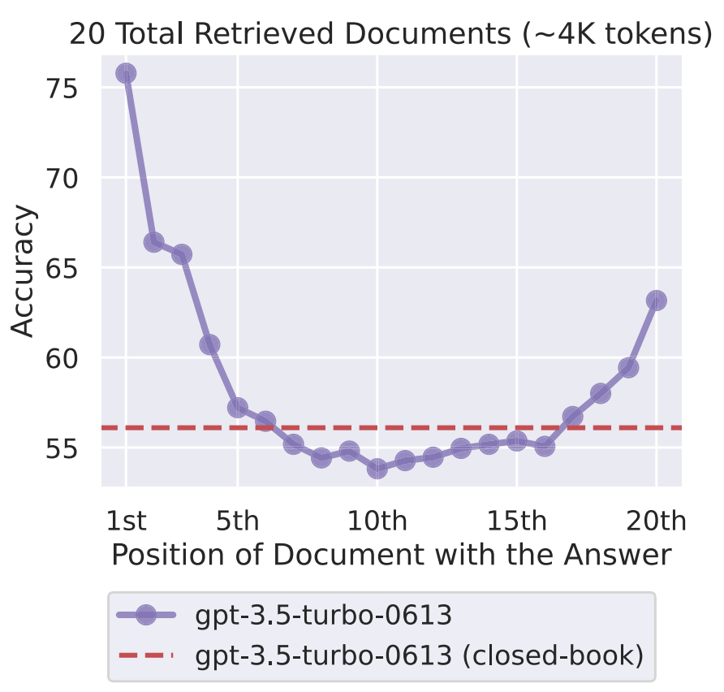

这张单栏图检验文档位置是否影响问答准确率。横轴是答案文档在 20 篇输入文档中的位置。纵轴是 GPT-3.5-Turbo 的准确率。紫线表示带文档问答，红虚线表示同模型不读文档。中间位置较低，首尾较高。

1. **图例与结论范围：**图例注明模型与条件。结论限该模型与 20 文档设置。纵轴非零起点，不能按曲线高度比较倍数。

[Liu et al. · Lost in the Middle (TACL 2024), Fig. 1, p. 158 / PDF p. 2](https://aclanthology.org/2024.tacl-1.9/)

Nelson F. Liu et al., Lost in the Middle: How Language Models Use Long Contexts, TACL 12 (2024), Fig. 1, p. 158. CC BY 4.0. 从正式 PDF 提取图面；图形、坐标、文字和图例未改。

<a id="visual-tcod-fig-1"></a>
#### 问题与解法对照

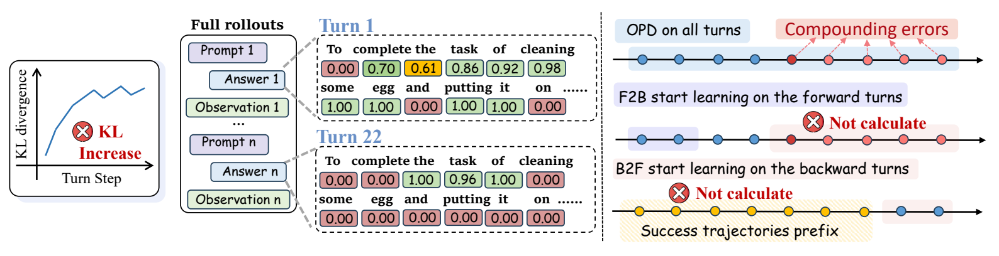

左侧示意误差随轮次变化，中间放大回复细节。右侧对照三种训练范围，指出改动位置。

1. **左侧问题：**KL随轮次变化提出问题。这是示意曲线，不是实测结果。

2. **中间回复细节：**从完整轨迹放大到两轮回复，文本与数值就近放置。数值含义须由原图注定义。

3. **右侧训练范围：**三条时间线同向排列，对照训练范围。未计算的轮次须说明原因。

[TCOD: Exploring Temporal Curriculum in On-Policy Distillation for Multi-turn Autonomous Agents · arXiv:2604.24005v3, Fig. 1, PDF p. 2](https://arxiv.org/abs/2604.24005v3)

Jiaqi Wang et al., TCOD, arXiv:2604.24005v3, Fig. 1. CC BY 4.0. 从原页裁切；图形与数据未改。

<a id="visual-tcod-fig-3"></a>
#### 训练范围对照

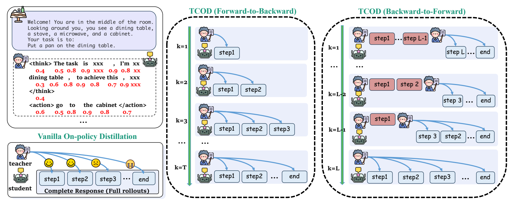

基线与两种课程共用步骤框和师生图标。沿轮数展开，可直接比较训练范围。

1. **左侧基线：**完整轨迹与师生关系为两种课程提供共同参照。

2. **中间与右侧：**两种课程复用步骤框、师生图标与箭头。只改变训练范围，便于比较。

3. **轮数与颜色：**沿轮数向下读课程变化。图注须定义颜色、轮数标签与训练目标。

[TCOD: Exploring Temporal Curriculum in On-Policy Distillation for Multi-turn Autonomous Agents · arXiv:2604.24005v3, Fig. 3, PDF p. 5](https://arxiv.org/abs/2604.24005v3)

Jiaqi Wang et al., TCOD, arXiv:2604.24005v3, Fig. 3. CC BY 4.0. 从原页裁切；图形与数据未改。

<a id="visual-interactcs-fig-1"></a>
#### 多任务框架的分组与连接

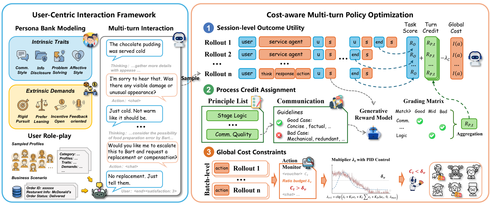

流程分为交互生成与策略优化。结果、过程和成本信号分别编号。旁边用对话实例走完流程。

1. **左侧输入分组：**用户特征、外部需求和业务场景分组，说明交互输入。

2. **中间对话：**对话实例沿流程展开，解释抽象模块。自己的案例须处理身份信息。

3. **右侧编号模块：**结果、过程与成本信号分别编号。分组明确职责，箭头表示信息流，编号表示步骤。

4. **右上评分输出：**Task Score、Turn Credit和Global Cost并排。输入、回复与评分信号各有位置。

[Reinforcing Real-world Service Agents: Balancing Utility and Cost in Task-oriented Dialogue · arXiv:2602.22697v1, Fig. 1, PDF p. 4](https://arxiv.org/abs/2602.22697v1)

Ning Gao et al., Reinforcing Real-world Service Agents, arXiv:2602.22697v1, Fig. 1. CC BY 4.0. 从原页裁切；图形与数据未改。

</details>

<details><summary>诊断与训练动态</summary>

**训练或轮次动态**：折线只连有序变量，横轴写训练步数或轮次。无序方法不连成趋势。

<a id="visual-tcod-fig-4"></a>
#### 效果与机制曲线

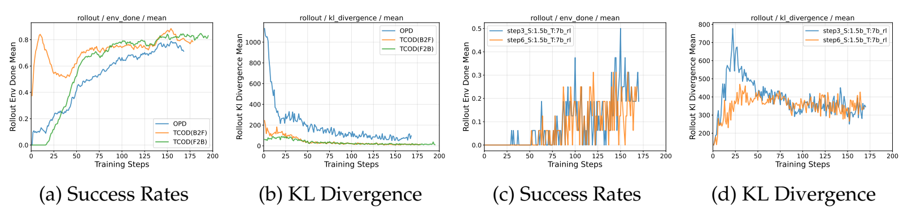

成功率与 KL 共用训练步数，便于对照效果与诊断。曲线同步变化不证明因果。

1. **相邻面板：**成功率与KL并排，对照效果与诊断。同步变化不证明因果。

2. **共用横轴：**面板共用训练步数，便于按同一时刻比较。不同指标各用自己的纵轴。

3. **面板图例：**颜色区分训练条件。原图部分图例为日志简写，写论文时须改为清楚的名称。

[TCOD: Exploring Temporal Curriculum in On-Policy Distillation for Multi-turn Autonomous Agents · arXiv:2604.24005v3, Fig. 4, PDF p. 8](https://arxiv.org/abs/2604.24005v3)

Jiaqi Wang et al., TCOD, arXiv:2604.24005v3, Fig. 4. CC BY 4.0. 从原页裁切；图形与数据未改。

<a id="visual-tcod-fig-5"></a>
#### 辅助指标对照

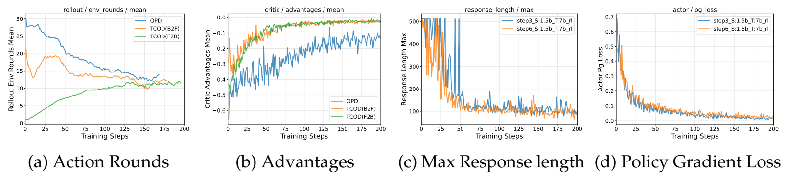

轮数、优势、长度和损失各占一格，共用训练步数。不同单位不用同一纵轴。

1. **四个指标面板：**轮数、优势、最大回复长度与损失各占一格。不同单位不用同一纵轴。

2. **共用训练步数：**横轴一致，便于在同一时刻对照过程指标。

3. **损失曲线：**损失曲线描述训练，不能替代最终任务实验。

[TCOD: Exploring Temporal Curriculum in On-Policy Distillation for Multi-turn Autonomous Agents · arXiv:2604.24005v3, Fig. 5, PDF p. 9](https://arxiv.org/abs/2604.24005v3)

Jiaqi Wang et al., TCOD, arXiv:2604.24005v3, Fig. 5. CC BY 4.0. 从原页裁切；图形与数据未改。

<a id="visual-tcod-fig-2"></a>
#### 多面板诊断

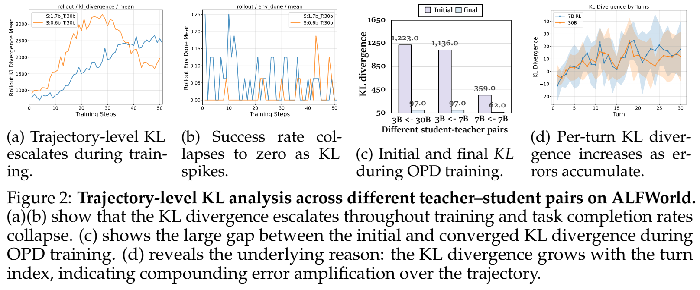

每个师生组合并排放 Initial／final 两根柱子。颜色区分阶段，柱顶标数值。

1. **左侧训练诊断：**(a)(b)共用训练步数，对照KL变化与成功率。曲线同步变化不证明因果。

2. **中间配对柱图：**每个师生组合并排放Initial与final。横轴箭头注明配对方向，柱顶标数值。

3. **柱图纵轴：**纵轴从50开始。应读数值，不能按柱高比较倍数。

4. **右侧轮次曲线：**按对话轮次展示KL，补充训练步数之外的诊断。色带含义须由原图注说明。

[Jiaqi Wang et al. · arXiv:2604.24005v3 · Fig. 2](https://arxiv.org/abs/2604.24005v3)

Jiaqi Wang et al., arXiv:2604.24005v3, Fig. 2. CC BY 4.0. 从原 PDF 裁切；图形与数据未改。

<a id="visual-interactcs-fig-3"></a>
#### 训练动态

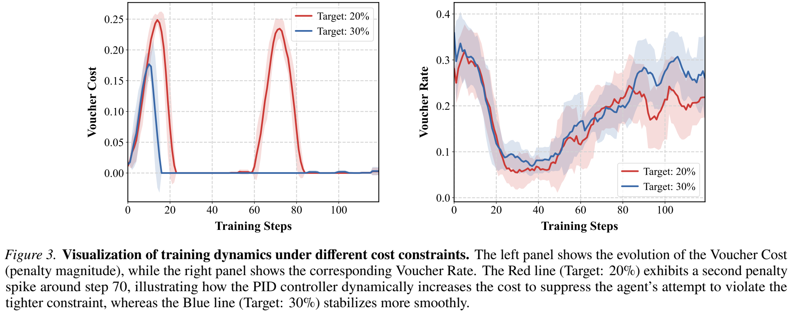

左侧画成本，右侧画使用率，共用训练步数。红蓝固定对应两种目标，便于对照变化。

1. **左侧成本与右侧使用率：**控制量与实际行为并排，共用训练步数。便于按同一时刻对照变化。

2. **两幅图的红蓝线：**红蓝分别对应20%与30%目标，跨面板保持同色。

3. **半透明色带：**图面未定义色带。不能擅称方差、标准误或置信区间。

[Ning Gao et al. · arXiv:2602.22697v1 · Fig. 3](https://arxiv.org/abs/2602.22697v1)

Ning Gao et al., arXiv:2602.22697v1, Fig. 3. CC BY 4.0. 从原 PDF 裁切；图形与数据未改。

</details>

<details><summary>消融与资源成本</summary>

**主结果与消融**：少量方法用点图或柱图。完整方法与消融版本保持同顺序、同配色。注明误差的统计单位与算法。

<a id="visual-tcod-fig-6"></a>
#### 方法效果比较

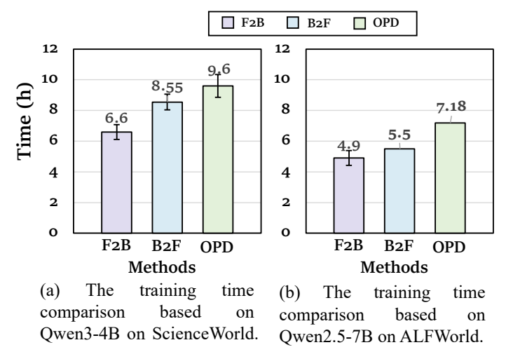

两个任务各一幅图，方法顺序一致，柱顶注明小时数。用实际训练时间说明计算成本。

1. **两幅任务图：**每个任务一幅图，方法顺序一致，便于比较。

2. **柱顶数值与单位：**柱顶标小时数，纵轴写Time (h)。这是训练耗时，不是在线推理延迟。须另交代硬件与训练条件。

3. **柱顶误差线：**原图未完整定义误差线。不能擅自补成标准差、置信区间或特定重复次数。

[TCOD: Exploring Temporal Curriculum in On-Policy Distillation for Multi-turn Autonomous Agents · arXiv:2604.24005v3, Fig. 6, PDF p. 10](https://arxiv.org/abs/2604.24005v3)

Jiaqi Wang et al., TCOD, arXiv:2604.24005v3, Fig. 6. CC BY 4.0. 从原页裁切；图形与数据未改。

<a id="visual-interactcs-fig-2"></a>
#### 结果图的分组比较

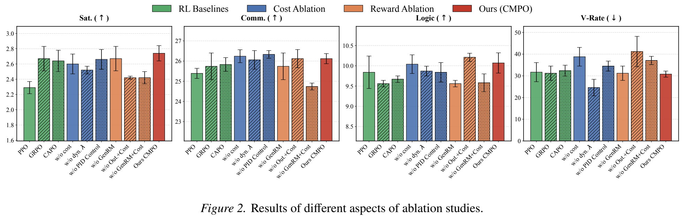

颜色区分方法族，实色、斜线和点纹区分组内方案。四个面板共用图例，柱顶保留误差棒。

1. **顶部共享图例：**颜色区分方法族，实色、斜线和点纹区分组内方案。四个面板共用编码。

2. **指标标题箭头：**↑与↓标出指标的优劣方向，避免把违规率下降读成性能变差。

3. **柱顶误差棒：**保留已有误差棒，但图面未定义其含义。不能擅称标准差或置信区间。

4. **前三幅纵轴：**前三图纵轴非零起点，不能按柱高比较倍数。应读坐标与数值差异。

[Ning Gao et al. · arXiv:2602.22697v1 · Fig. 2](https://arxiv.org/abs/2602.22697v1)

Ning Gao et al., arXiv:2602.22697v1, Fig. 2. CC BY 4.0. 从原 PDF 裁切；图形与数据未改。

</details>

<details><summary>案例</summary>

**案例图**：白底保留必要背景、需求、证据、动作与结果。高亮颜色区分信息类型。边框区分输入、模型输出与 judge，位置对应真实层级。

<a id="fig-interactcs-case"></a>
#### 交互案例


深色标题交代案例，浅底分栏列出评价和用户设定；完整对话接在后页。

1. **观察 1：**作者笔记强调像UI一样整洁：相同信息放一起，同类信息用同样的框，颜色只强调重点。

2. **观察 2：**左栏是三个评价结果，右栏是用户设定；标题、字段与数值分层，不必为每个字段单独设置对话框。

3. **观察 3：**字多时先分组、删重复、留白。放回双栏PDF后仍须检查字号；网页放大看清不等于论文里看清。

[Ning Gao et al. · Reinforcing Real-world Service Agents (arXiv v1)](https://arxiv.org/abs/2602.22697v1)

Ning Gao et al., Reinforcing Real-world Service Agents, arXiv:2602.22697v1. CC BY 4.0（https://creativecommons.org/licenses/by/4.0/）。从原 PDF 裁切；图形、标签和数据未改。

</details>

<details><summary>KDE 密度分布</summary>

**KDE：看分布形状**：横轴是变量，纵轴是密度。颜色区分组别，均值线标位置，并注明样本量和带宽。峰高不是人数或累计比例。

<a id="teaching-kde"></a>
#### KDE 密度分布

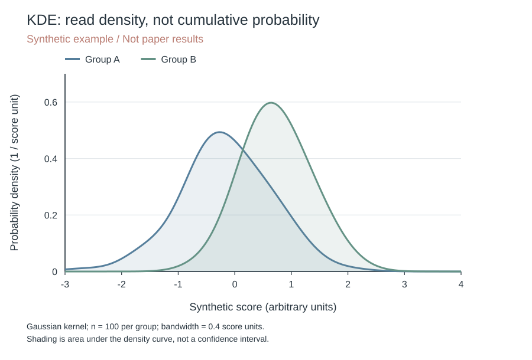

两组模拟分数共用坐标，曲线高处样本更密集。浅色填充表示曲线下面积。

1. **横轴与纵轴：**横轴是模拟分数，纵轴是密度。曲线高处样本更密集，不表示累计比例。

2. **两组曲线与填充：**两组共用坐标，比较分布位置。浅色填充为曲线下面积，不是置信区间。

3. **底部计算说明：**每组100个模拟样本，使用高斯核，固定带宽0.4。每条密度曲线面积约为1。

[可复现教学绘图代码](../assets/generate-statistical-examples.py)

StarPaper 原创教学图 · 模拟数据，非论文结果 · CC BY 4.0

</details>

<details><summary>ECDF 累计分布</summary>

**ECDF：看阈值以下有多少**：横轴取阈值，纵轴读不超过阈值的累计比例。两组共用坐标，阶梯从 0 到 1。KDE 峰高不表示累计比例。

<a id="teaching-ecdf"></a>
#### ECDF 累积分布

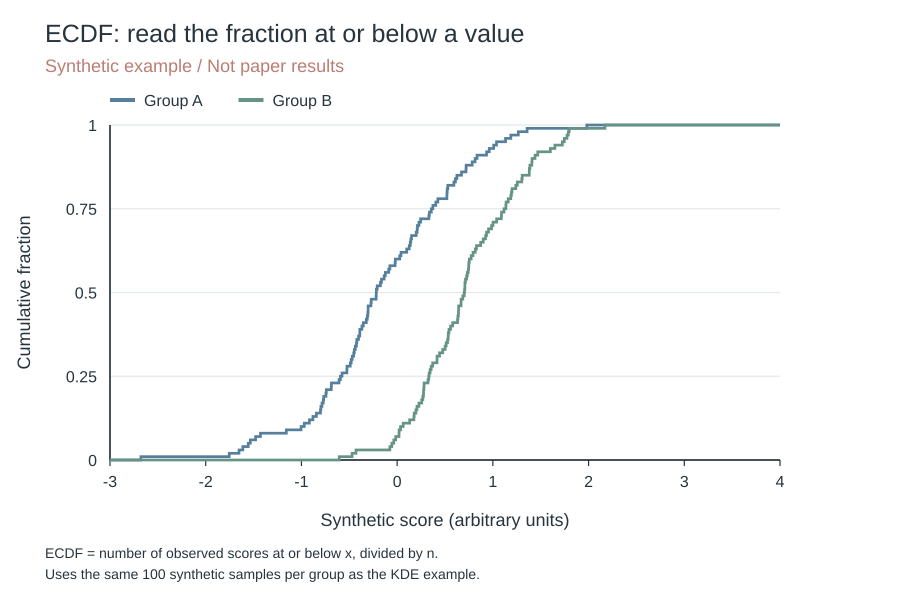

阶梯线在每个样本处上升。纵轴表示累计样本比例，不是平滑密度。

1. **阶梯线：**曲线在每个样本处上升。纵轴是不超过当前横轴值的样本比例。

2. **两组共用坐标：**同一阈值下，线高之差表示累计比例差，不是密度差。

3. **底部样本说明：**与KDE使用同一批模拟样本，每组100个。比例由计数得到，无需平滑。

[可复现教学绘图代码](../assets/generate-statistical-examples.py)

StarPaper 原创教学图 · 模拟数据，非论文结果 · CC BY 4.0

</details>

<details><summary>PCA / 空间嵌入</summary>

**PCA：把高维关系投到二维**：位置展示数据关系，颜色区分属性。注明特征、标准化方式与解释方差。分得开不等于泛化好；PaCMAP、t-SNE 不叫 PCA。

<a id="teaching-pca"></a>
#### PCA 二维投影

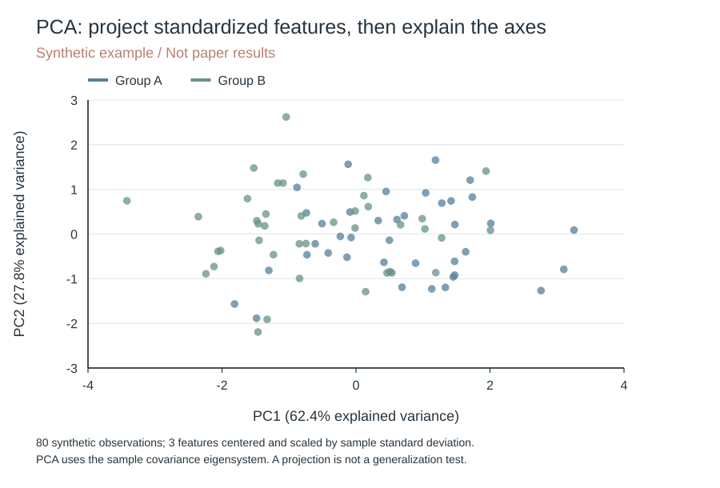

三个标准化特征投到前两主成分。坐标轴标出实算的解释方差。

1. **两个主成分轴：**轴上标实算的解释方差：PC1为62.4%，PC2为27.8%。

2. **散点颜色：**颜色表示原分组，PCA未用分组训练。投影分开不证明分类准确或泛化成立。

3. **底部输入说明：**80个模拟样本、3个特征先中心化，再除以样本标准差。主成分由协方差矩阵求得。

[可复现教学绘图代码](../assets/generate-statistical-examples.py)

StarPaper 原创教学图 · 模拟数据，非论文结果 · CC BY 4.0

</details>

<details><summary>雷达与多指标</summary>

**雷达图：多指标逐轴读**：每轴一个指标，注明尺度、归一化和好坏方向。颜色再配点形。不同量纲不能按面积比较，轴顺序也会影响面积。

<a id="teaching-radar"></a>
#### 雷达图：多指标比较

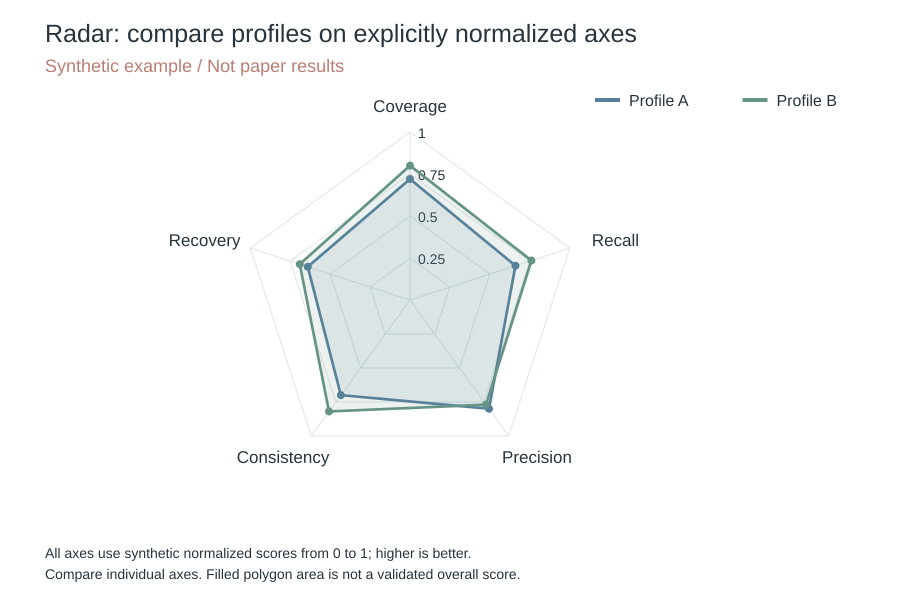

各轴均为0到1模拟分数，越高越好。点与线同色，沿各轴比较，不比较多边形面积。

1. **各指标轴：**各轴均为0到1，越高越好。真实图须说明归一化方法。

2. **点、线与颜色：**同一组的点与线保持同色，逐轴比较各项表现。

3. **填充多边形：**本图未定义综合分数，多边形面积不代表总能力。

[可复现教学绘图代码](../assets/generate-statistical-examples.py)

StarPaper 原创教学图 · 模拟数据，非论文结果 · CC BY 4.0

</details>

<details><summary>置信带</summary>

**置信带**：按实际重采样或模型计算区间。注明区间类型与置信水平。同一估计的嵌套区间才能比较覆盖范围。样本量和方差也会影响带宽。

<a id="teaching-confidence"></a>
#### 置信区间与误差带

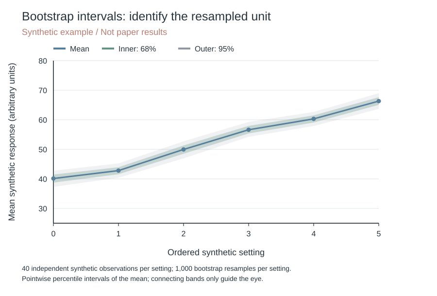

深线是模拟样本均值。内外层分别是68%、95%的逐点bootstrap区间。带宽由计算得到。

1. **均值线与两层色带：**深线表示模拟样本均值。内外层分别为68%、95%的逐点bootstrap区间。宽度由计算得到。

2. **底部重采样说明：**每个设置有40个独立模拟观测。有放回重采样1000次，再取均值分位数。

3. **色带的解释范围：**区间针对各均值，不是整个函数的同时置信带。也不表示观测值落在带内。

[可复现教学绘图代码](../assets/generate-statistical-examples.py)

StarPaper 原创教学图 · 模拟数据，非论文结果 · CC BY 4.0

</details>

<details><summary>配对增益</summary>

**配对增益**：同一样本的干预与对照，画差值和零线；写清收益方向与尺度。

<a id="teaching-paired-gain"></a>
#### 配对增益

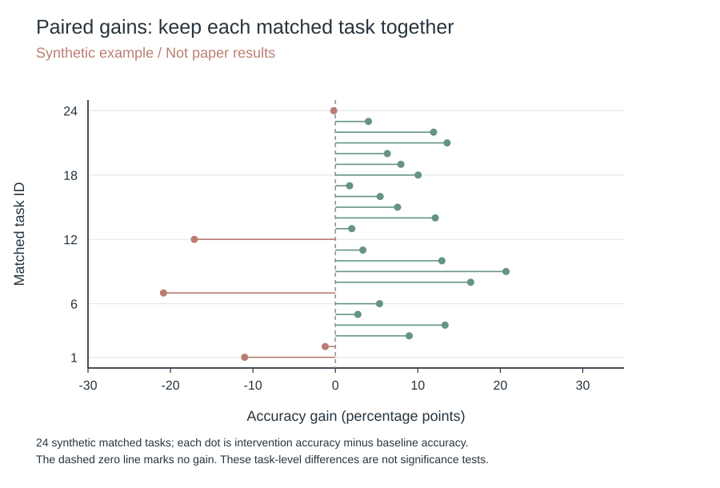

每点表示一项模拟任务的干预减基线。零线右侧提高、左侧下降，保留收益与失败。

1. **每个任务一个点：**24个模拟任务各自保留配对关系。每点是同一任务的干预准确率减基线准确率。

2. **虚线零点：**零线右侧提高，左侧下降，收益与失败一起展示。

3. **横轴单位：**单位是百分点，不是相对百分比。散点未做显著性检验，也不替代总体汇总。

[可复现教学绘图代码](../assets/generate-statistical-examples.py)

StarPaper 原创教学图 · 模拟数据，非论文结果 · CC BY 4.0

</details>

<details><summary>热图</summary>

**热图**：条件乘方法，统一色标；正负增益以零为中点，缺测留空并说明。

<a id="teaching-heatmap"></a>
#### 热图：分组结果

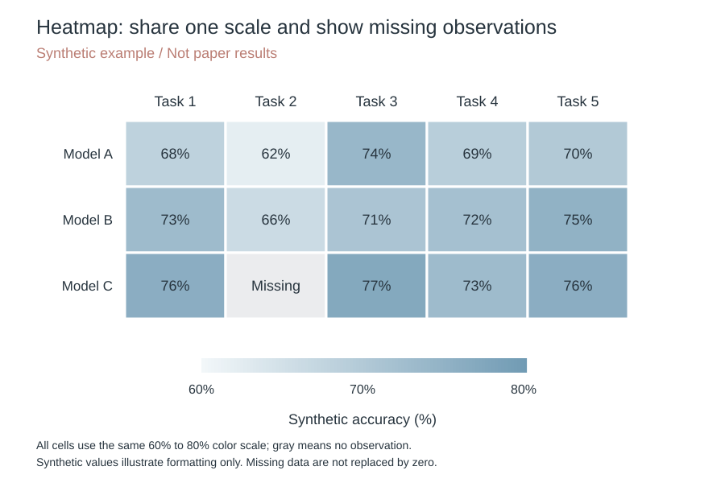

行列对应模型与任务，颜色和数值共用尺度。缺测格标Missing，不记作零分。

1. **行列与格内数字：**模型与任务交叉排列，格内标数值，方便不辨色的读者。

2. **底部统一色标：**全图共用60%到80%色标。不逐行归一化后继续比较颜色。

3. **灰色Missing格：**灰色格标Missing，表示缺测，不记为零分。

[可复现教学绘图代码](../assets/generate-statistical-examples.py)

StarPaper 原创教学图 · 模拟数据，非论文结果 · CC BY 4.0

</details>

<details><summary>成本性能图</summary>

**成本性能图**：每点对应实际配置，注明单位和好坏方向。在线与离线成本分开。前沿连线不代表存在中间配置。

<a id="teaching-cost"></a>
#### 成本与性能

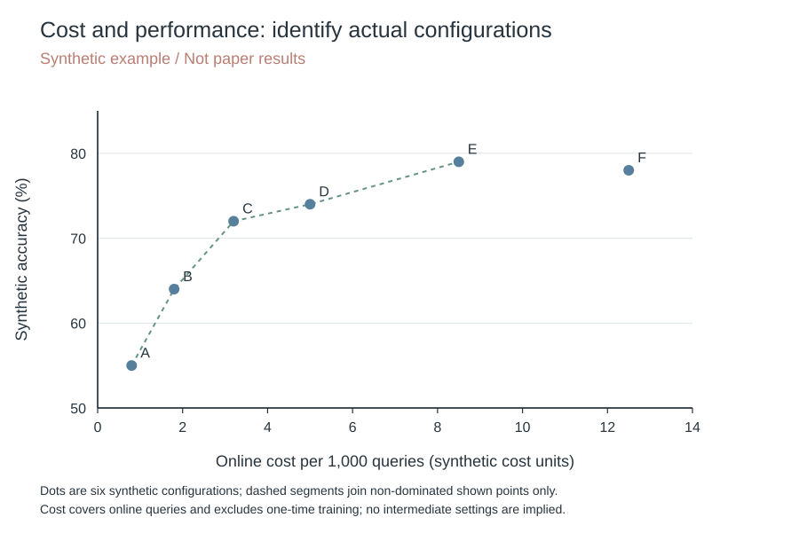

横轴是模拟在线成本，纵轴是准确率。每个字母对应一项配置。虚线只连接已展示的非支配点。

1. **成本与准确率两轴：**横轴是每1000次查询的模拟在线成本。纵轴是准确率，一次性训练成本须另报。

2. **字母配置点：**每个字母对应一项模拟配置，便于追溯成本与表现。

3. **虚线连接：**虚线只连接已展示的非支配点。不证明中间配置或连续最优函数存在。

[可复现教学绘图代码](../assets/generate-statistical-examples.py)

StarPaper 原创教学图 · 模拟数据，非论文结果 · CC BY 4.0

</details>

<details><summary>饼图与环图</summary>

**数据集分布**：注明统计单位、样本量、类别与分母。案例数、回复数和判据数分开统计。说明类别覆盖范围与占比。

**饼图、环图与圆环排名**：饼图只展示互斥、合成整体的比例。圆环柱图可排排名，相邻极值不代表变量相关。精确比较差值时，用横向条图。

<a id="teaching-donut"></a>
#### 环图：组成比例

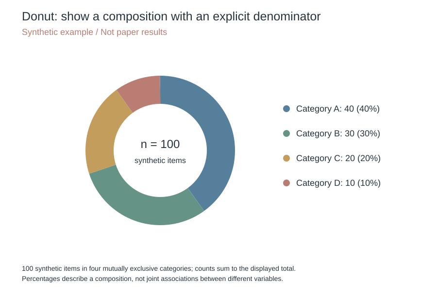

中心注明100个模拟对象，旁边列数量与比例。四类互斥，共同构成整体。

1. **中心总数：**中心注明100个模拟对象，明确统计单位与分母。

2. **右侧数量与比例：**四类数量为40、30、20、10，总和为100。数量与比例同时列出。

3. **四个扇区：**四类互斥，共同构成整体。精确比较相近比例时，用数值或横向条图。

[可复现教学绘图代码](../assets/generate-statistical-examples.py)

StarPaper 原创教学图 · 模拟数据，非论文结果 · CC BY 4.0

</details>

<details><summary>二维增益</summary>

**二维增益与九宫格**：两轴写明指标、单位和好坏方向。差值图用零线分区，呈现两项变化及其取舍。不为填满网格补造数据。

<a id="teaching-two-gain"></a>
#### 双指标增益

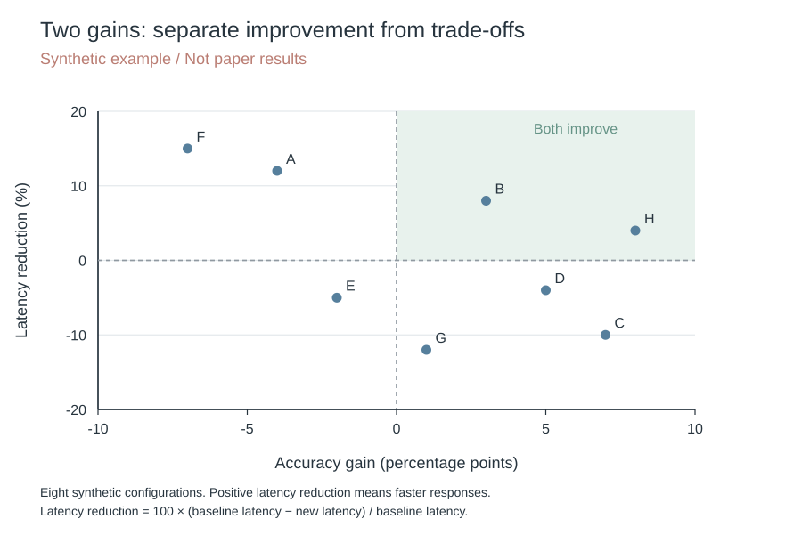

准确率增益向右更好，延迟减少向上更好。零线分四区，右上表示两项同时改善。

1. **横轴与纵轴方向：**准确率增益向右更好，延迟减少向上更好。横轴用百分点，纵轴用相对百分比。

2. **两条零线与右上区：**零线分四区，右上表示两项同时改善。其余象限显示不同取舍。

3. **配置点与结论范围：**每点是模拟配置，不是论文结果。象限只说明这两项指标的关系，不证明总体优越。

[可复现教学绘图代码](../assets/generate-statistical-examples.py)

StarPaper 原创教学图 · 模拟数据，非论文结果 · CC BY 4.0

</details>

<details><summary>优化前后教学示意</summary>

<a id="teaching-mainfig-before-after"></a>
#### 模板 1：问题与改动对照

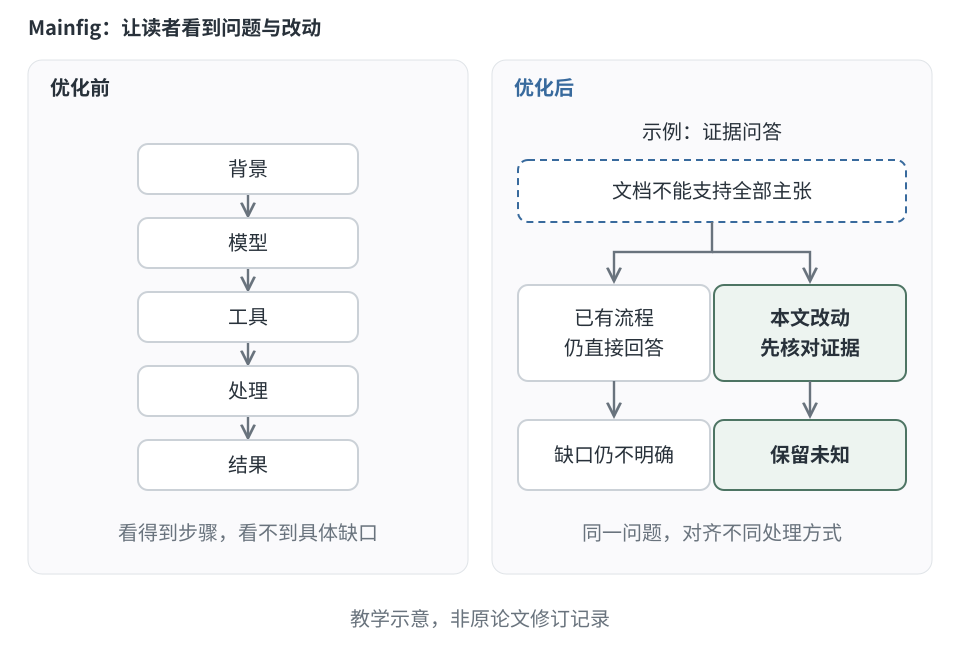

这是假设的证据问答任务。左侧流程过于抽象，右侧明确缺口和改动。缺口是证据不足仍回答，改动是核对证据、保留未知。此图只展示设计，不证明效果。

1. **观察 1：**先定缺口，删除无关节点。两侧使用同一问题与读序，并对齐改动位置。

StarPaper 原创教学改排，CC BY 4.0；非原论文修订记录。

<a id="teaching-framework-before-after"></a>
#### 模板 1：输入、产物与评价分离

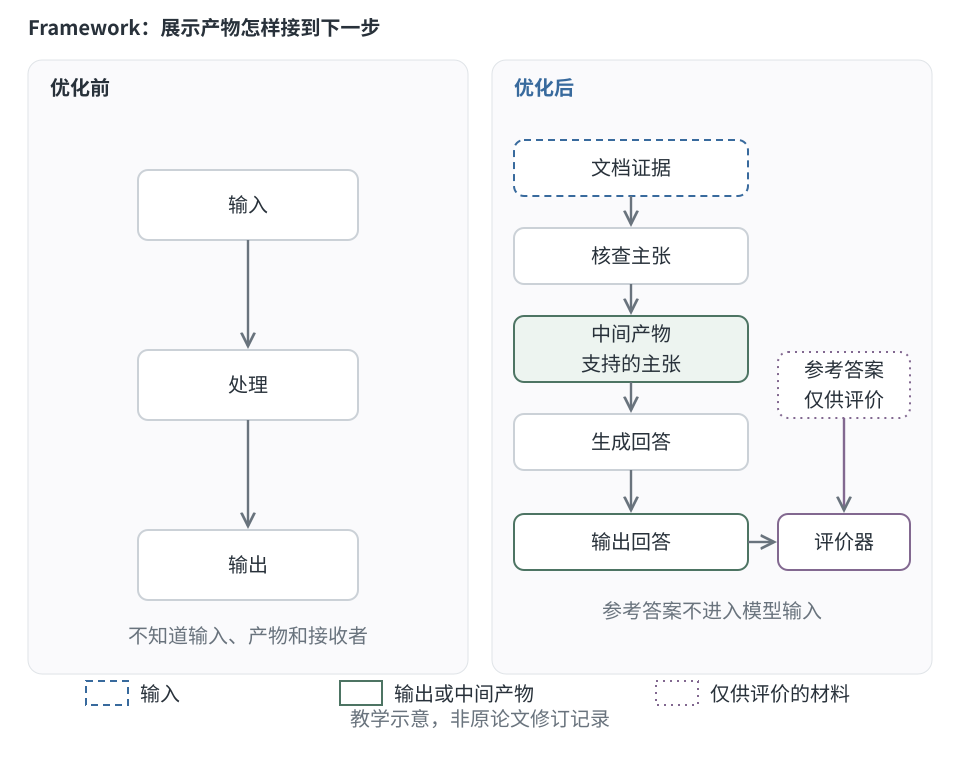

这是假设的文档问答流程。左侧只有泛称；右侧写清证据、被支持的主张和回答。参考答案送往独立评价器。

1. **观察 1：**前后使用同一任务，箭头注明传递材料。参考答案仅供评价，不接入回答生成。

StarPaper 原创教学改排，CC BY 4.0；非原论文修订记录。

</details>

<details><summary>均值与原始分布</summary>

**小样本：均值之外看原始观测**：小样本连续值优先展示原始点与样本量。可叠均值或区间；观测较多时可用箱线图或分布图。均值相同不代表分布相同。计数、比例等汇总量仍可用柱图。

<a id="teaching-mean-distribution"></a>
#### 小样本：均值相同，分布不同

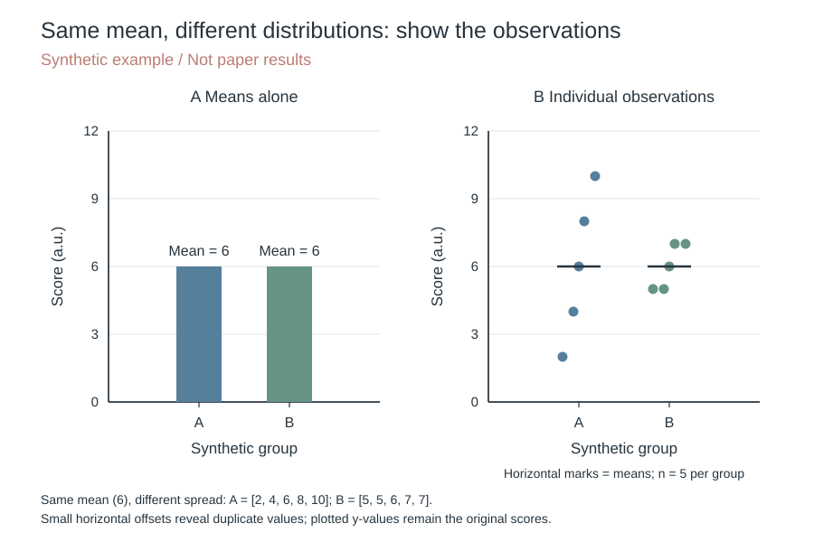

左侧两柱均为6，右侧各显示5个模拟观测。A分散、B集中，均值线相同。

1. **观察 1：**横轴分组，纵轴为任意单位的模拟分数。两侧坐标均为0到12。

2. **观察 2：**A为2、4、6、8、10，B为5、5、6、7、7。黑横线表示组均值，水平错开仅防重叠。

3. **观察 3：**均值柱没有显示组内分布。此图展示小样本连续值，未做统计检验。它不表示所有柱状图都不合适。

[可复现教学绘图代码](../assets/generate-statistical-examples.py)

StarPaper 原创教学图 · 模拟数据，非论文结果 · CC BY 4.0

</details>

<details><summary>重叠点与二维计数</summary>

**散点遮挡：必要时改看二维计数**：重叠点可能隐藏数量和少数类别。先调透明度，检查密集区与稀疏区能否分清。大量重叠时用二维或六边形分箱。注明每格计数、范围与箱宽。保留真实坐标，不为分开点而移动数值。未定义时，颜色深浅不表示概率。

<a id="teaching-overlap-count"></a>
#### 散点遮挡：重叠点与二维计数

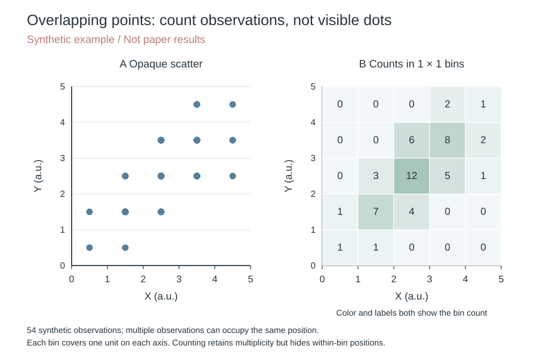

两侧共用54个模拟点。左侧同位置的点完全重叠，右侧按1×1格计数并标数。

1. **观察 1：**两侧横纵轴均为任意单位，范围为0到5。左侧每点代表一个观测，同位置会互相遮挡。

2. **观察 2：**每格横纵各覆盖一个单位。颜色与数字表示格内观测数，也包含零计数。

3. **观察 3：**分箱保留重复数量，但丢失格内位置。须说明箱宽，颜色不能直接读作概率。

[可复现教学绘图代码](../assets/generate-statistical-examples.py)

StarPaper 原创教学图 · 模拟数据，非论文结果 · CC BY 4.0

</details>

<details><summary>连续色标与基准</summary>

**连续色标：让明暗顺序对应数值**：类别用离散色板，连续量用明暗有序的色标。偏离有意义的基准时，用发散色标。连续量不默认用 rainbow／jet。其明暗不均可能掩盖差异或制造边界。保留已有颜色含义，并检查灰度下的数值顺序。

<a id="teaching-continuous-color"></a>
#### 连续色标：不要让配色制造边界

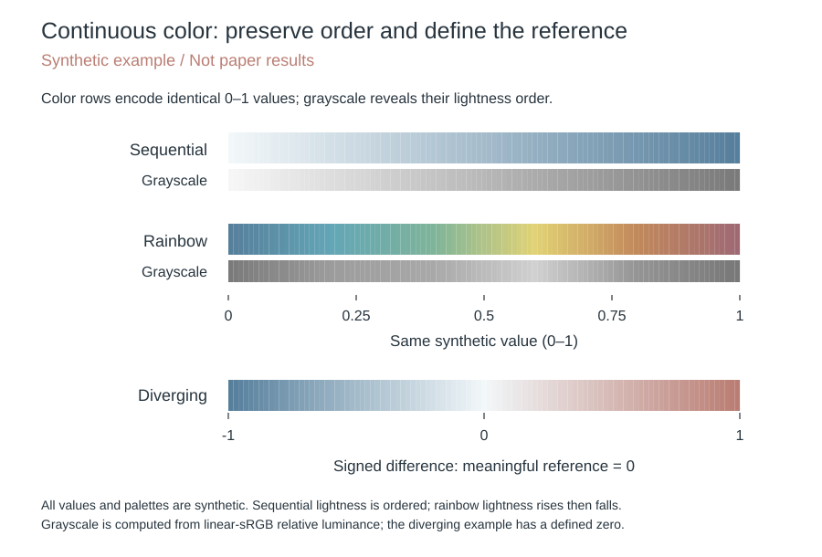

相同0到1数值分别用顺序色标和彩虹色标。灰度行检查亮度顺序。下方发散色标以零居中，显示正负差值。

1. **观察 1：**上方两行横向位置对应相同的0到1模拟值。灰度按线性sRGB相对亮度计算，不是另一批数据。

2. **观察 2：**顺序色标随数值增加变暗。彩虹色标中部变亮，可能制造不存在的数据边界。颜色变化不等于真实分组。

3. **观察 3：**下方范围为−1到1，浅色中心表示零差值。需区分基准两侧时才用发散色标。

[可复现教学绘图代码](../assets/generate-statistical-examples.py)

StarPaper 原创教学图 · 模拟数据，非论文结果 · CC BY 4.0

</details>

<details><summary>气泡面积编码</summary>

**【铁律】气泡面积与数量成正比**：气泡表示非负数量时，面积须与数量成正比。半径取数量的平方根，并给大小图例与单位。数量增至 4 倍，面积增至 4 倍、半径增至 2 倍。关系来自 A = πr²；其他颜色与位置编码另解释。

<a id="teaching-bubble-area"></a>
#### 气泡编码：数量对应面积

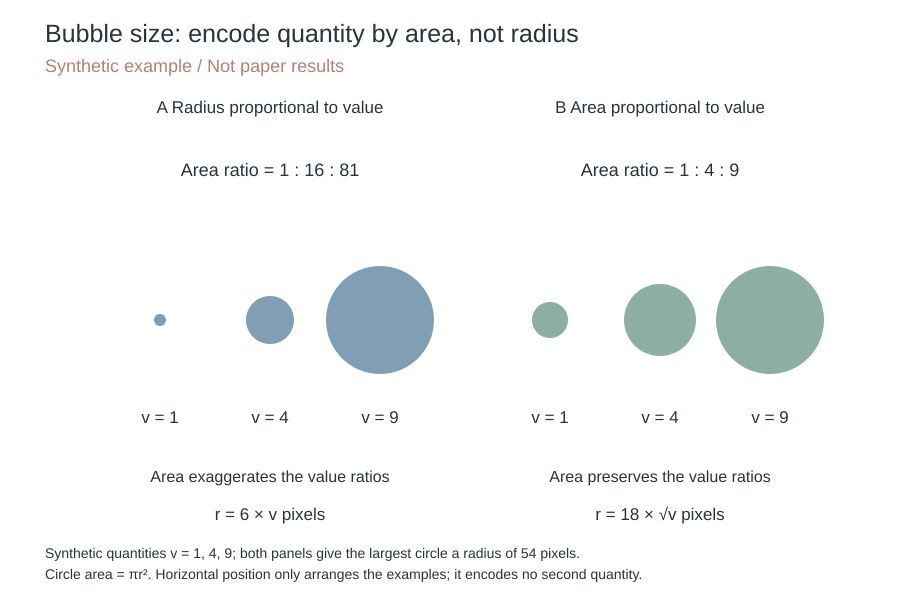

两侧数量均为1、4、9。左侧按半径缩放，面积变为1、16、81。右侧半径取平方根，保持面积比例。

1. **观察 1：**本图对照三种数量的编码，不含数据坐标轴。横向位置只作排列，v表示模拟数量。

2. **观察 2：**圆面积为πr²。左侧r=6v，右侧r=18√v。两侧最大半径均为54像素，便于比较比例。

3. **观察 3：**圆大小表示数量时，面积须成比例。人不易精确估计面积，重要比较仍须标数值或位置。

[可复现教学绘图代码](../assets/generate-statistical-examples.py)

StarPaper 原创教学图 · 模拟数据，非论文结果 · CC BY 4.0

</details>

<details><summary>误差线重叠与判断</summary>

**误差线重叠：先认类型与比较设计**：不能只凭误差线是否重叠判断显著性。先看 SD、SE 或 CI 类型、样本量及独立／配对设计。用对应检验，或直接估计差值与区间。保留误差类型、重复单位和区间定义，不凭图补 p 值。

<a id="teaching-errorbar-overlap"></a>
#### 误差线：重叠不构成通用判据

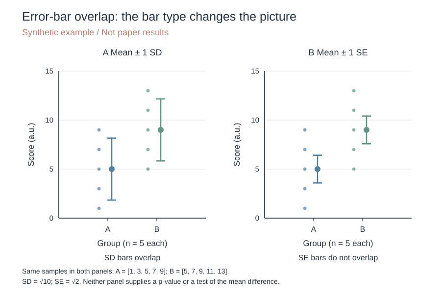

两组模拟观测与均值不变。SD误差线重叠，SE误差线不重叠。

1. **观察 1：**两侧各组均有5个构造观测。横轴分组，纵轴为任意单位分数。小点是观测，大点是均值5和9。

2. **观察 2：**样本SD以n−1为分母，均为√10。SE=SD/√5=√2。左侧为均值±1SD，右侧为均值±1SE。

3. **观察 3：**两种误差线回答不同问题，本图未算p值。重叠不是通用显著性判据。正式比较须按独立或配对设计选择检验或差值区间。

[可复现教学绘图代码](../assets/generate-statistical-examples.py)

StarPaper 原创教学图 · 模拟数据，非论文结果 · CC BY 4.0

</details>

<a id="figure-references"></a>
<details><summary>更多原图链接与点评</summary>

[15-minute cities 图 1：地图、分布、多维散点](https://arxiv.org/html/2408.03794v1#S2.F1)：地图定位差异，累计分布显示人口覆盖。散点横轴是人口加权平均邻近时间。纵轴是 15 分钟覆盖人口比例。颜色表示 Gini，圆大小表示人口密度。灰区是受概率约束的不可达组合。平均不到 15 分钟，不代表人人可达。

适合同时展示总体分布与个体差异。位置、颜色、大小等编码各有含义，信息过多就拆图。

Bruno et al., A universal framework for inclusive 15-minute cities, Nature Cities (2024), DOI 10.1038/s44284-024-00119-4; arXiv:2408.03794v1

只链接原图，不重托管。arXiv 非独占分发许可。

[15-minute cities 图 2：算法、排名、前后变化](https://arxiv.org/html/2408.03794v1#S2.F2)：先画人口导向的 POI 重分配，再排城市迁移比例。最后用罗马的地图与直方图对照前后变化。POI 是服务设施点。(b) 排现有 POI 的迁移比例，不是新增设施数。

依次回答怎么做、改动多大、改到哪里。排名比较城市，地图定位变化，直方图展示分布。

Bruno et al., A universal framework for inclusive 15-minute cities, Nature Cities (2024), DOI 10.1038/s44284-024-00119-4; arXiv:2408.03794v1

只链接原图，不重托管。arXiv 非独占分发许可。

[OneReason 图 12：对照策略的改动位置](https://arxiv.org/pdf/2606.06260v1#page=34)：相同结构对齐，突出改动位置，图注解释符号。只链接读图，不复制整图。


[KDE：OneReason 图 6](https://arxiv.org/pdf/2606.06260v1#page=13)：四个领域并排，同一方法始终同色。淡填充保留重叠，虚线与均值标注说明位置变化。

横轴是 Margin，纵轴是密度，不是累计概率。Margin 是否表示任务收益，须看原文定义。

OneRec Team, OneReason Technical Report, arXiv:2606.06260v1, Fig. 6

只链接原图，不重托管。该版本采用 arXiv 非独占分发许可。

[投影：life2vec 图 4，PaCMAP 与局部放大](https://www.nature.com/articles/s43588-023-00573-5/figures/4)：中间展示嵌入空间，两侧放大选定区域。同一批点分别按性别、年龄和真实标签着色。位置保持不变，便于对照属性。

原图使用 PaCMAP。投影与 TCAV 属于不同证据，不能合成因果结论。

Savcisens et al., Nature Computational Science 4, 43–56 (2024), Fig. 4, DOI 10.1038/s43588-023-00573-5

只链接出版社图页；期刊版本未标明可转载的 CC 许可。

[OneReason 图 1：把模型身份和结果放一起](https://arxiv.org/pdf/2606.06260v1#page=1)：左侧雷达比较任务表现。右侧成对柱图比较推理与训练数据的作用。颜色、纹理和数值各有含义，升降都明确标出。

雷达各轴须定义量纲和归一化，不能凭面积判能力。柱顶相对增幅与原分数同时保留。百分比不等于百分点，下降项也须展示。

OneRec Team, OneReason Technical Report, arXiv:2606.06260v1, PDF p. 1

只链接原图，不重托管。该版本采用 arXiv 非独占分发许可。

[OneReason 图 7：颜色跟着流程职责走](https://arxiv.org/pdf/2606.06260v1#page=19)：两侧保持相同网络层次，只改雪花与火焰标记。直接对照第一阶段与后续阶段更新的参数。

图例解释图标，不能让读者猜蓝色是否表示冻结。同层位置一致，便于比较训练范围。此图不说明阶段间性能差异。

OneRec Team, OneReason Technical Report, arXiv:2606.06260v1, PDF p. 19

只链接原图，不重托管。该版本采用 arXiv 非独占分发许可。

[OneReason 图 9：分布与多维特征分开读](https://arxiv.org/pdf/2606.06260v1#page=29)：左侧堆叠条展示五档评分比例。右侧雷达概括五项均分，先读分布，再读轮廓。

两面板使用同一组维度。雷达标数值，堆叠条展示评分构成。雷达面积不替代具体分数。

OneRec Team, OneReason Technical Report, arXiv:2606.06260v1, PDF p. 29

只链接原图，不重托管。该版本采用 arXiv 非独占分发许可。

[ShoppingBench 图 1、2：任务概览与案例层级](https://ojs.aaai.org/index.php/AAAI/article/view/40640)：案例左侧依次展示请求、工具调用、观察和结果。右侧拆开产品、优惠券和预算，高亮连接需求与检查。构建图上方分产品采样和字段采样。下方逐行对齐提示模板与生成指令。同类任务同色，便于追踪结果来源。

背景、需求、动作与反馈分层。颜色和高亮各有用途，不靠密集箭头补逻辑。

ShoppingBench: A Real-World Intent-Grounded Shopping Benchmark for LLM-based Agents, AAAI 2026, Fig. 1–2

只链接正式论文页，不重托管原图。

</details>

<a id="reading"></a>

## 相关参考和推荐阅读

- [Weissgerber 等（2015）· 小样本连续数据为何需要展示原始观测](https://journals.plos.org/plosbiology/article?id=10.1371/journal.pbio.1002128)：原始点揭示均值与误差条隐藏的分布、离群点及配对。适用于小样本连续数据，不设统一样本阈值。不禁止所有柱图。
- [Wilke（2019）· 散点重叠的处理](https://clauswilke.com/dataviz/overlapping-points.html)：先调点大小与透明度。密集散点可用二维分箱或 hexbin，解释计数或密度。保留真实坐标，不用 jitter；分箱不保留逐点位置。
- [Wilke（2019）· 颜色使用的常见误区](https://clauswilke.com/dataviz/color-pitfalls.html)：连续量用明暗有序的色标，避免 rainbow/jet 误导。类别用离散色，偏离基准时用发散色。不指定唯一色板。
- [Rougier 等（2014）· 科研绘图的十条建议](https://doi.org/10.1371/journal.pcbi.1003833)：按读者与主要信息选图，核对布局、颜色和说明。气泡表示非负数量时，面积须成比例，不能直接缩放半径。示意形状不套用定量比例。
- [Cumming 等（2007）· 误差条与组间差异的解读](https://pmc.ncbi.nlm.nih.gov/articles/PMC2064100/)：区间比较取决于误差类型、独立样本数及独立／配对设计。特定条件的重叠近似规则不能推广为通用判据。配对比较使用差值及其不确定性。

### 写作指南、投稿要求与示例论文

- [Mensh & Kording (2017) · Ten simple rules for structuring papers](https://doi.org/10.1371/journal.pcbi.1005619)：中心贡献、读者视角与文章结构。按研究需要取舍写法。
- [Henderson & Chambers (2022) · Ten simple rules for writing a Registered Report](https://doi.org/10.1371/journal.pcbi.1010571)：研究问题、适用的假设与预先规划。不要求每篇都写 RQ1/H1。
- [NeurIPS · Paper Checklist](https://neurips.cc/public/guides/PaperChecklist)：主张、限制、设置、不确定性与复现。投稿遵循当年指南。
- [ACL Rolling Review · Responsible NLP Research](https://aclrollingreview.org/responsibleNLPresearch/)：NLP 研究责任与披露要求。其他领域须查对应投稿政策。
- [Liu et al. (2024) · Lost in the Middle, Figure 1 / §2](https://aclanthology.org/2024.tacl-1.9/)：控制证据位置，比较问答表现。适合学习“现象—诊断”的论证。
- [TCOD (2026 预印本) · Figure 1](https://arxiv.org/pdf/2604.24005v3)：监督案例与课程设计并排。概念图不证明实际效果。
- [Reinforcing Real-world Service Agents (2026 预印本) · Figure 1](https://arxiv.org/html/2602.22697v1#S4.F1)：框架图明确交互环境、轨迹、学习信号与更新对象。模拟表现不代表真实部署收益。
- [NeurIPS 2026 · Main Track Handbook V2026.3，Author Responses](https://neurips.cc/Conferences/2026/MainTrackHandbook)：2026 主会的回复流程、匿名、篇幅与新结果要求。其他年份与赛道须另查。核查日期：2026-10-07。
- [ICLR 2026 · Author Guide，Discussion Stages](https://iclr.cc/Conferences/2026/AuthorGuide)：2026 讨论期修订与变更说明。审稿人和 AC 不必读每版，投稿遵循当轮通知。核查日期：2026-10-07。
- [ACL Rolling Review · Authors Guidelines，Author response](https://aclrollingreview.org/authors#author-response)：截至 2026-10-07 可见的作者回复指南。此版注明适用至 2026 年 8 月轮次，后续须重查。可了解 ARR 与直接投会议的区别。
- [Yuqin Dai et al. (AAAI 2025) · Harmonious Music-driven Group Choreography with Trajectory-Controllable Diffusion](https://ojs.aaai.org/index.php/AAAI/article/view/32268)：署名短引讲解贡献、动机、方法与实验。各处标节名、页码与中文翻译，英文保留原句。教学改写另标，结论限原文任务与比较条件。
- [Yuqin Dai et al. (AAAI 2026) · Careful Queries, Credible Results: Teaching RAG Models Advanced Web Search Tools with Reinforcement Learning](https://ojs.aaai.org/index.php/AAAI/article/view/40299)：AAAI 2026 正式发表，保留 AAAI 版权。终稿短引用于讲解问题、搜索、奖励、指标与消融。
- [Pengyu Zeng et al. (EMNLP 2025) · CARD: Cross-modal Agent Framework for Generative and Editable Residential Design](https://aclanthology.org/2025.emnlp-main.473/)：EMNLP 2025 正式发表，原文采用 CC BY 4.0。讲解模块输入输出、公平比较、人评重复与表示转换。中文由本指南翻译。
- [Zeng, Dai et al. (2026 预印本) · PlanCraft: Sketch, Refine, and Furnish for Architect-Inspired Progressive 3D Residential Scene Generation](https://arxiv.org/abs/2607.23491v3)：短引公开预印本，讲解渐进设计、总览、模块与结果。Fig.2 用于流程分析。英文、翻译和教学改写分开标注，结论限原文设置。
- [Chaoyang Shi, Yuqin Dai et al. · UrbanZero（公开项目介绍）](https://github.com/Da1yuqin/Da1yuqin.github.io/blob/main/_pages/includes/pub.md#L193-L202)：据公开项目介绍编写任务编译、逐块规划与程序反馈示例。教学实验与模拟回复不代表原文或实测结果。
- [Ling Shi, Yuqin Dai et al. · SAGE: An Extensible Benchmark for Service Agent Graph-guided Evaluation](https://arxiv.org/abs/2604.09285)：短引讲解术语、指标、比较、相关工作、论证与案例排版。不复制私有评审材料，模拟回复不是真实 rebuttal。
- [Yuqin Dai et al. · EviNoteRAG: Enhancing RAG Models via Quality-Augmented Evidence Notes](https://arxiv.org/abs/2509.00877)：八处短引讲解摘要、背景、近邻比较与引文用途。另讲真实材料、润色边界与逐点回复。数值限终稿表中比较，模拟回复不是真实评审记录。
- [Pengyu Zeng et al. (CVPR Findings 2026) · GreenPlanner: Practical Floorplan Layout Generation via an Energy-Aware and Function-Feasible Generative Framework](https://openaccess.thecvf.com/content/CVPR2026F/html/Zeng_GreenPlanner_Practical_Floorplan_Layout_Generation_via_an_Energy-Aware_and_Function-Feasible_CVPRF_2026_paper.html)：署名短引、中文翻译与写作拆解。区分数据合规、生成结果与不同输入。法规设置不推广为一般建筑指导。
- [Yuqin Dai et al. (IJCV 2026；引文为 arXiv v4) · TCDiff++: An End-to-end Trajectory-Controllable Diffusion Model for Harmonious Music-Driven Group Choreography](https://link.springer.com/article/10.1007/s11263-025-02611-3)：讲解模块命名、设置、问题与设计、收益与代价。说明未实现能力的边界。仅署名短引，不复制期刊原图或全文。
- [Jiaqi Wang et al. · TCOD (arXiv v3)](https://arxiv.org/abs/2604.24005v3)：多轮智能体蒸馏。图2讲解如何串联训练诊断。公开预印本，CC BY 4.0。
- [Ning Gao et al. · Reinforcing Real-world Service Agents (arXiv v1)](https://arxiv.org/abs/2602.22697v1)：服务智能体的质量与成本。图2/3及附录案例讲解编码、动态与排版。公开预印本，CC BY 4.0。
- [OneReason Technical Report · Figure 12](https://arxiv.org/pdf/2606.06260v1#page=34)：训练策略对照图，仅链接分析，不转载。arXiv 分发许可不等于图片复用许可。
- [Bruno et al. (2024) · A universal framework for inclusive 15-minute cities](https://arxiv.org/html/2408.03794v1)：地图、累计分布、多维气泡与设施迁移排名。只链接原图，点评由本指南整理。颜色和大小按原图注解释。
- [pymoo · Pareto dominance](https://pymoo.org/getting_started/preface.html)：多目标比较与非支配解的定义
- [Callaway & Sant’Anna · Difference-in-Differences with Multiple Time Periods](https://arxiv.org/abs/1803.09015)：DID 的比较设计与平行趋势识别条件
- [Yuqin Dai et al. · EviNote-RAG: Enhancing RAG Models via Answer-Supportive Evidence Notes](https://arxiv.org/html/2509.00877v3#S5)：Conclusion 首段展示如何收束设计、作用与结果。表现判断仅对应该版本的比较。
